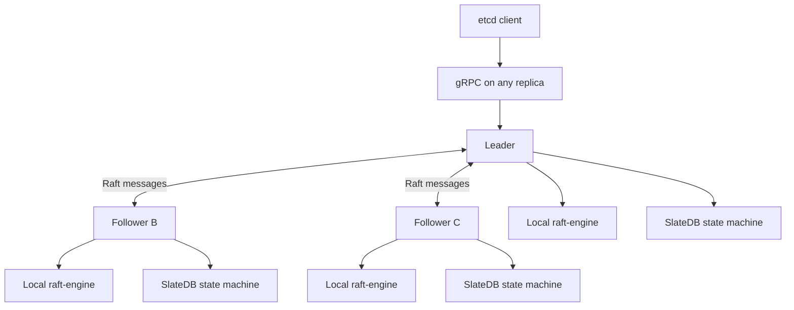
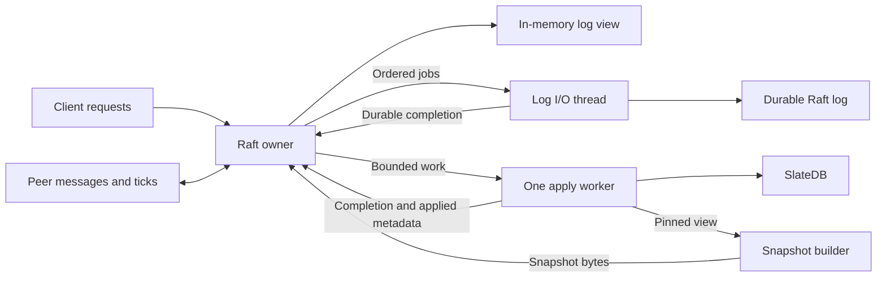

# Architecture and implementation plan

This document defines the storage contract, execution model, and project roadmap.
The baseline is commit `0b1509e`, which added Watch and Lease support.
Commit `fc967ed` completed phase 1. This change adds ReadIndex and separates Raft log I/O.
Sections marked as targets describe work that is not implemented yet.

## Purpose and scope

Build an etcd v3 compatible service with Raft commit durability and a SlateDB state machine.
Keep object writes off the normal commit path. Preserve recovery of acknowledged writes.
Validate correctness before making claims about latency, cost, or deployment readiness.

The current service has one Raft group and three fixed voters.
It uses `raft-rs`, `raft-engine`, and SlateDB. It does not embed TiKV or use PD.
All listeners and peers use loopback addresses. Each replica has its own storage directory.
SlateDB currently uses `LocalFileSystem`, not a remote object store.
No replica shares its manifest or SST ownership with another replica.

KV, Txn, logical Compact, Watch, and Lease are implemented.
Auth, Cluster, Maintenance, TLS, quotas, and physical compaction remain incomplete.
This service is not yet a supported replacement for etcd or a Kubernetes backend.

## Components

Each replica runs the same components. A follower forwards operations that require the leader.
Local serializable reads and Watch use the receiving replica's applied state.
The diagnostic JSON API uses a separate keyspace from the etcd API.

| Component | Responsibility |
| --- | --- |
| gRPC service | Validate requests, forward leader requests, and manage streams |
| Raft owner | Run elections, stage Ready, send permitted messages, and track completion |
| Log worker | Persist Ready, publish snapshots, reclaim files, and collect disk statistics |
| raft-engine | Store log entries, terms, votes, commit position, and recovery snapshots |
| Apply owner | Execute committed entries in order and maintain state metadata |
| SlateDB | Store current values, history, event journals, leases, and the apply marker |
| Snapshot builder | Flush and serialize a pinned state view |
| Test drivers | Compare etcd behavior and check recovery, histories, and schedules |

## Persistent layout

Each node stores its Raft log under `<node-dir>/raft` and SlateDB objects under
`<node-dir>/objects`.
SlateDB uses these logical keys:

| Prefix or key | Content |
| --- | --- |
| `meta/applied` | Last applied Raft index |
| `data/` | Diagnostic JSON keyspace |
| `etcd/current/` | Current values and key metadata |
| `etcd/history/` | Historical versions and tombstones |
| `etcd/revision` and `etcd/compact-revision` | MVCC progress and retained history boundary |
| `etcd/events/` and `etcd/watch-floor` | Ordered events and the first complete journal revision |
| `etcd/leases/` | Lease TTL and generation |

The full snapshot preserves these keys together. A checkpoint has one pinned apply boundary.

## Baseline execution model

At the baseline commit, one node loop owns both RawNode and StateMachine.
That loop persists Raft updates, applies entries, reads state, and installs snapshots.
Snapshot creation already runs in a background task after it pins an applied view.

This model preserves order, but slow state work can delay Raft ticks and peer responses.
History scans, lease key scans, compaction, and snapshot installation can all cause this delay.
A past checkpoint stall caused leader changes during local benchmarks.
See [the original experiment](../RESULTS.md#failure-found-during-development).

## Durability and ordering contract

The service must preserve these rules across every implementation phase:

1. Persist terms, votes, and entries before sending dependent vote or append acknowledgements.
2. Persist the commit position before submitting entries to the state machine.
3. Apply a committed prefix in index order. Never apply an uncommitted entry.
4. Store each state change and its apply marker in one SlateDB batch.
5. Reply with write success only after quorum commit, local log persistence, and local apply.
6. Advance RawNode's applied position only after the apply owner reports completion.
7. Reclaim log entries only after a durable snapshot covers them.
8. Stop the node after a state storage failure. Do not continue from uncertain state.

The SlateDB sequence number equals the Raft apply index.
The etcd MVCC revision is separate. A mutating transaction advances that revision once.
Reads, lease grants, renewals, and empty deletes do not advance the KV revision.

SlateDB's native WAL is disabled. The replicated Raft log protects committed state before flush.
This removes a separate SlateDB WAL write from the normal commit path.
It does not remove local disk writes or the need for a quorum.
A timeout or leader change can leave a request's result unknown. There is no retry deduplication.

## Apply isolation design

The Raft owner retains RawNode, an in-memory log view, peer transport, and pending proposals.
A dedicated operating-system thread owns raft-engine and all steady-state log I/O.
One apply worker owns StateMachine. State reads and mutations run through that owner.
The worker executes committed batches, snapshot installation, local reads, and Watch scans.
It also pins checkpoints. A separate task builds each pinned snapshot.

The Raft owner must not wait for a full apply queue.
It keeps the remaining committed work in the durable log and submits bounded batches.
The implementation allows one active worker job.
It bounds queued local reads and rejects excess requests with an explicit retryable error.
It also rejects new proposals when the local apply backlog reaches its admission limit.
Each entry batch contains at most 32 entries with a 512 KiB byte target.
A single larger entry can exceed that byte target. Full snapshots retain the 64 MiB peer limit.
At most 64 local queries and 64 checkpoint requests can wait at the Raft owner.
New proposals are rejected at 1,024 committed but unapplied entries.
These limits bound queued work; they do not impose a total storage quota.

Completion reports carry the applied index, revision, compaction boundary, and lease metadata.
The Raft owner uses this cached metadata for status, admission, and lease scheduling.
It never treats a submitted batch as completed work.
Client replies must remain tied to proposal IDs. A role change can invalidate a pending reply.

Local reads use the worker's applied state. They may lag durable commit.
ReadIndex now serves linearizable Range requests and transactions that contain only reads.
Both transaction branches must contain only reads, including nested transactions.
Mutating transactions, Lease operations, and the diagnostic JSON API retain their log path.
Queued reads must receive service between apply batches, so continuous writes cannot starve them.

A slow worker must delay client completion without delaying Raft heartbeats.
Worker failure or panic must terminate the node. Node shutdown must cancel the worker.
The deterministic driver executes the same worker jobs under an explicit scheduler.

## ReadIndex protocol

The receiving replica forwards linearizable reads to the leader.
The leader submits a unique context through raft-rs Safe ReadIndex.
The context includes a process nonce and a counter, so restart cannot reuse an old context.
Raft confirms leadership through a quorum and returns the associated committed index.
It also requires a committed entry in the leader's current term.

The owner waits for local application through that index before scheduling the state read.
Local application already requires a durable local commit position.
The apply worker evaluates the entire read-only transaction against one applied state view.
The owner checks the term and leadership again before returning the result.
Leadership loss, a five-second timeout, or client cancellation removes the pending request.
At most 64 ReadIndex requests can wait. These requests do not append log entries.

Serializable reads still use the local applied prefix without quorum confirmation.
A local commit counter cannot replace the ReadIndex quorum exchange.

## Raft log I/O protocol

The owner stages each Ready in its memory view before calling `advance_append_async`.
This makes entries and terms readable through the synchronous Raft Storage interface.
A FIFO worker persists Ready updates, checkpoint publication, log reclamation, and disk statistics.
The owner calls `on_persist_ready` only after it receives the matching completion.
It then releases the associated persisted messages and ReadIndex states.
Errors or worker panic stop the node.

Raft permits leaders to send replication messages before their own local persistence completes.
Follower vote and append acknowledgements remain behind their persistence barrier.
Ordinary HTTP receipt only confirms message delivery. It does not confirm Raft persistence.
Holding that receipt behind disk I/O would block the peer's subsequent heartbeat responses.
Snapshot HTTP receipt remains behind durable snapshot storage, before state installation.

The queue contains at most 64 jobs and uses a 16 MiB admission target.
One Ready or full snapshot can exceed that byte target.
The owner rejects new proposals when this queue or the apply backlog reaches its admission limit.
A worker failure stops progress instead of reporting an uncertain write as durable.
Shutdown cancels queued work and injected delays. A running kernel I/O call must finish before
its thread releases the storage lock.

The memory view contains the entire retained Raft log.
Startup loads those entries before serving requests. Durable checkpoints remove covered entries.
This avoids synchronous log reads in the Raft loop, but memory grows with the retained log.
Disabling checkpoints removes that reclamation path. The cache has no independent memory quota.
A bounded cache with asynchronous entry fetch is future work for larger deployments.

Status separates `raft_commit_index` from durable `commit_index`.
It also exposes `cached_last_log_index`, `log_busy`, queued log jobs and bytes, and pending reads.
Snapshot installation waits if the memory view contains a snapshot that is not durable yet.
Entry selection pauses until that snapshot becomes durable.
Apply cannot select entries from a cache prefix that the new snapshot removed.

## Snapshot order and recovery

A checkpoint request waits for the Raft commit index observed when the request arrived.
It then pins the exact applied view and its index.
The builder flushes SlateDB, then serializes that pinned view.
The log worker saves the snapshot and truncates its covered log prefix in one synchronous batch.
Only then can raft-engine reclaim obsolete log files.

The current snapshot includes all logical state and duplicates that data in raft-engine.
The peer transport has a 64 MiB limit. Large deployments need a different transfer design.

On receipt, persist a remote snapshot in raft-engine before installing it in SlateDB.
The worker must install it before applying later entries.
An older active batch can finish before installation, but it must not move state past the snapshot.
Status must distinguish durable snapshot receipt from completed state installation.
Raft can acknowledge durable receipt while state installation is still pending.

On restart:

1. Open raft-engine and verify the node identity.
2. Open SlateDB and read its durable apply marker.
3. Install a newer durable Raft snapshot if required.
4. Replay committed entries after the recovered marker.
5. Serve state only through the recovered and subsequently applied prefix.

A crash after snapshot persistence but before state installation is recoverable.
Startup repeats installation from the durable snapshot payload.
No checkpoint may truncate entries above its pinned apply index.

## MVCC, Watch, and Lease

The current index serves point and range reads. History retains versions and tombstones.
Logical compaction retains the boundary version and deletes older redundant versions.
MVCC compaction and Raft log reclamation are separate operations.

Each mutation stores ordered Watch events in the same batch as its key changes and revision.
Watch reads this journal after reconnect, restart, or snapshot installation.
Progress must not pass undelivered events. Compacted history produces a cancellation.
Old databases have no complete journal before their first write with Watch support.

The leader proposes lease expiry. Followers never delete keys from local lease clocks.
Expiry includes a generation, so an obsolete expiry cannot delete a renewed lease.
Revocation deletes all attached keys and records their Watch events at one revision.

Leader promotion currently resets each surviving lease to its full granted TTL.
Remaining TTL is not checkpointed. Loss of quorum delays committed expiry.
Apply isolation must retain these semantics and must not acknowledge a renewal before apply.

## Target storage and deployment architecture

The first remote-store deployment will retain one independent SlateDB owner per replica.
Each replica will use a separate object prefix and manifest.
This is the closest extension of the current recovery contract.
It can create three copies of SST data and repeat object-store work.
Cost reduction from shared SSTs is not established by this design.

Shared SST ownership requires a separate design for publication, fencing, retention, and deletion.
A shared bucket alone does not make multiple manifest writers safe.
That work must not weaken recovery or let one replica delete another replica's required data.

Target checkpoints should refer to durable immutable objects where possible.
They need ownership rules, integrity checks, bounded transfer, cancellation, and resumable recovery.
Until that design exists, full snapshots remain the supported mechanism.

Cross-host operation needs secure peer transport, identity checks, and operational controls.
Measurements must include the real gRPC and MVCC path, remote storage, and independent disks.
Local JSON benchmarks do not establish remote-store latency or cost.

## Roadmap and exit criteria

| Phase | Deliverable | Exit criterion |
| --- | --- | --- |
| 1 | Isolate state apply and reads from Raft | Slow apply preserves heartbeats and reply ordering |
| 2 | ReadIndex and a separate log I/O thread | Reads and persistence preserve their barriers |
| 3 | TLS, Auth, membership, and Maintenance | Matching upstream cases run without skips |
| 4 | Remote store and cross-host tests | Recovery and measured costs use real storage |
| 5 | Object-reference snapshots and lease indexes | Bound transfer and scan work for large state |
| 6 | Wider fault injection and simulation | Reproduce storage and clock fault regressions |

Phases 1 and 2 now separate state work and log I/O from the Raft owner.
The apply worker remains a Tokio task and shares CPU and disk resources with other process work.
Large scans, full snapshots, and lease metadata copies still need bounded work and memory controls.
Remote storage, membership changes, and object-reference snapshots remain future work.

The phase 2 tests cover quorum loss, apply lag, read cancellation, and unchanged log write counts.
They cover delayed log writes, failed writes, delayed checkpoint publication, and worker failure.
DST controls log execution and completion separately from state application.
It injects a disk write failure, restarts that node, and checks persistence-dependent messages.
Read histories must contain every write acknowledged before each read began.

The phase 1 tests cover:

- Commit moving ahead of apply while heartbeat and status requests continue.
- No successful write response before apply completes.
- Recovery after process death with a committed but unapplied backlog.
- Snapshot installation followed by later entries, without index regression.
- Bounded local query queues and proposal rejection under sustained lag.
- Worker failure, shutdown, and local checkpoint overlap.
- Existing differential, upstream, fault, Jepsen, fuzz, and deterministic schedule tests.

Later fault coverage must include slow and failed object writes, disk exhaustion, corruption,
interrupted installation, clock changes, and rolling upgrades.
DST should control apply completion and lease time before it claims full time determinism.
Current DST controls log job execution and completion delivery through the real storage executor.
It does not simulate partial sector writes, operating-system scheduling, or SlateDB background work.

## Implementation and evidence

- [Node and Raft integration](../src/node.rs)
- [Apply worker and bounded jobs](../src/node/apply.rs)
- [Log I/O worker and memory view](../src/node/log.rs)
- [ReadIndex request lifecycle](../src/node/read.rs)
- [Persistent Raft storage](../src/storage.rs)
- [State machine and snapshots](../src/state.rs)
- [MVCC](../src/mvcc.rs), [Watch](../src/watch.rs), and [Lease](../src/lease.rs)
- [Compatibility results](../COMPATIBILITY.md)
- [Test commands](../tests/README.md) and [upstream coverage audit](../tests/upstream/README.md)

Update this document when an ownership boundary, recovery rule, or roadmap phase changes.
