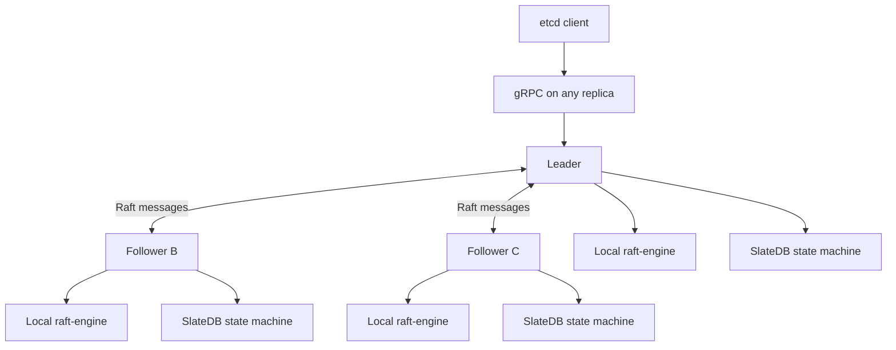
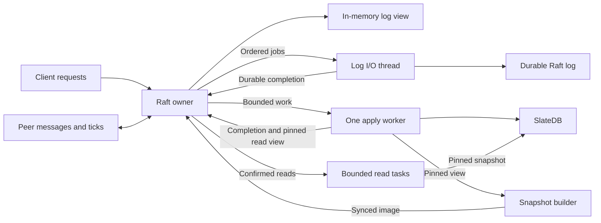

# Architecture and implementation plan

This document defines the storage contract, execution model, and project roadmap.
The current service separates Raft, log I/O, state apply, and pinned KV reads.
It groups ordinary Put entries and stores KV logs, history, and Watch journals as protobuf.
Sections marked as targets describe work that is not implemented yet.
See [module boundaries](modules.md) for the code map and change rules.

## Purpose and scope

Build an etcd v3 compatible service with Raft commit durability and a SlateDB state machine.
Keep object writes off the normal commit path. Preserve recovery of acknowledged writes.
Validate correctness before making claims about latency, cost, or deployment readiness.

The current service has one Raft group, a configurable voter set, and one optional learner.
It uses `raft-rs`, `raft-engine`, and SlateDB. It does not embed TiKV or use PD.

The CLI and Rust hosts use one `server::Server` lifecycle.
Startup binds listeners and opens storage.
Readiness confirms quorum ReadIndex and local apply.
Shutdown joins workers before releasing storage.
See [Rust embedding](embedding.md) for the API contract and client examples.
Each replica keeps its own durable Raft directory and local or S3 object namespace.
Remote listeners require separate client and peer ports with mutual TLS.
No replica shares its manifest or SST ownership with another replica.

KV, Txn, Compact, Watch, Lease, Auth, and Cluster are implemented.
Maintenance, TLS, backend quotas, and physical compaction have local integration coverage.
Native snapshots and backend hashes do not use the etcd bbolt format. Binary downgrade is
unsupported.
This service is not yet a supported replacement for etcd or a Kubernetes backend.

## Components

Each replica runs the same components. A follower forwards operations that require the leader.
Local serializable reads and Watch use the receiving replica's applied state.
The diagnostic JSON API uses a separate keyspace from the etcd API.

| Component | Responsibility |
| --- | --- |
| gRPC service | Validate requests, forward leader requests, and manage streams |
| Raft owner | Run elections, stage Ready, send permitted messages, and track completion |
| Log worker | Persist Ready, fetch entries, publish snapshots, and reclaim files |
| raft-engine | Store log entries, terms, votes, commit position, and recovery snapshots |
| Apply owner | Execute committed entries in order and publish matching read views |
| Read executor | Evaluate bounded KV reads on pinned data and metadata |
| SlateDB | Store current values, history, event journals, leases, and the apply marker |
| Snapshot builder | Create a SlateDB checkpoint and describe its objects |
| Object binding | Bind local identity to an exclusive S3 namespace |
| Test drivers | Compare etcd behavior and check recovery, histories, and schedules |

## Persistent layout

Each node stores its Raft log under `<node-dir>/raft`. Local objects use `<node-dir>/objects`.
S3 objects use an owned cluster/member prefix. A synced binding prevents accidental backend changes.
See [remote storage](remote-storage.md) for the namespace and claim protocol.
SlateDB uses these logical keys:

| Prefix or key | Content |
| --- | --- |
| `meta/applied` | Last applied Raft index |
| `meta/applied-term` | `(index, term)` of the last applied entry, two big-endian `u64` values |
| `data/` | Diagnostic JSON keyspace |
| `etcd/current/` | Current values and key metadata |
| `etcd/history/` | Historical versions and tombstones |
| `etcd/revision` and `etcd/compact-revision` | MVCC progress and retained history boundary |
| `etcd/events/` | Ordered Watch events with previous values or their history revisions |
| `etcd/leases/` | Lease TTL and generation |
| `etcd/auth` | Users, roles, bcrypt hashes, tokens, and authentication revision |
| `etcd/members` | Voters, learners, addresses, and removed member IDs |
| `etcd/alarms` | Replicated capacity and corruption alarms |
| `etcd/hash/` | Canonical etcd revision records for HashKV |
| `etcd/hash-cache` | Retained compaction hashes |
| `etcd/compact-pending` | Physical compaction progress |

The full snapshot preserves these keys together. A checkpoint has one pinned apply boundary.
The `meta/applied-term` term is valid only when its index equals `meta/applied`. Older binaries
advance `meta/applied` alone, so a different index or a missing row means an unknown term. The
next state batch stores the term again. A copied checkpoint with a known term must match the
Raft snapshot term. At startup, a durable Raft snapshot at the applied index fills an unknown
term in memory and must match a known term. Logical images and native backups omit the row.
Install takes the term from the Raft snapshot metadata. A restore starts in term 1 at the copied
row count plus one, in both state modes.

## Durability and ordering contract

The service must preserve these rules across every implementation phase:

1. Persist terms, votes, and entries before sending dependent vote or append acknowledgements.
2. Persist the commit position before writing those entries to SlateDB.
3. Apply a committed prefix in index order. Never apply an uncommitted entry.
4. Store each state change and the covered final apply marker in one SlateDB batch.
5. Require quorum commit and an exact state-machine result for every successful write reply.
6. Advance RawNode's applied position only after the apply owner reports completion.
7. Reclaim log entries only after a durable snapshot covers them.
   Flushed SlateDB state with its apply marker is such a snapshot.
8. Stop the node after a state storage failure. Do not continue from uncertain state.

The SlateDB sequence number equals the Raft apply index.
The etcd MVCC revision is separate. A mutating transaction advances that revision once.
Reads, lease grants, renewals, and empty deletes do not advance the KV revision.

SlateDB's native WAL is disabled. The replicated Raft log protects committed state before flush.
This removes a separate SlateDB WAL write from the normal commit path.
It does not remove local disk writes or the need for a quorum.
A timeout or leader change can leave a request's result unknown. There is no retry deduplication.

## Thread model

Each standalone member uses one process and one Raft group.
The main thread starts and supervises a Tokio runtime. By default it has one async worker per CPU
that the process may use. Linux limits this count by the affinity mask and the cgroup CPU quota.
`--runtime-workers` sets this count. An embedded member uses the caller's Tokio runtime.
The worker count changes only scheduling. The Raft owner and the apply task each remain one task,
so log order, apply order, and response order do not depend on it.
Each task can resume on another runtime worker after it yields.

| Work | Execution and ownership |
| --- | --- |
| Client and peer I/O | One Tokio task polls each connection and its HTTP/2 streams. |
| Raft | One task owns RawNode. It orders events, advances consensus, and dispatches work. |
| WAL | One dedicated `raft-log-io` OS thread per member writes, syncs, and reads the log. |
| Apply | One Tokio task per member writes SlateDB and publishes revisions in log order. |
| KV reads | Up to four Tokio tasks read pinned views. Three budgeted scans may share them. |
| Checkpoint | A task flushes state. Peer images use blocking workers to sync the file. |
| Other work | Blocking workers handle password checks, metrics encoding, and local object I/O. |

The client and peer tasks submit events through a queue with 2,048 slots.
The WAL thread publishes checkpoint metadata, or a synced image file, and syncs the truncation.
It prepares incoming peer snapshots in order before reporting durable completion.
The owner sends ordered work to WAL and apply. Each worker sends its result back to the owner.
Leader replication can proceed while the WAL thread waits for the disk.
A linear read obtains a quorum proof and waits for local apply before it uses a pinned view.

`--runtime-workers` counts only async scheduler threads. Tokio can add blocking threads on demand.
The WAL thread and blocking workers mostly wait for disk I/O, so one async worker per CPU does not
oversubscribe busy cores. SlateDB flush and compaction run as tasks on the same runtime.
Raft Engine also starts a metrics thread. Actual OS thread counts depend on load and storage.
One Linux three-member write run observed 12 to 33 OS threads per member with the default settings.
The count includes waiting threads. It does not measure the number of busy CPU cores.

## Apply isolation design

The Raft owner retains RawNode, an in-memory log view, peer transport, and pending proposals.
A dedicated operating-system thread owns raft-engine and all steady-state log I/O.
One apply worker owns StateMachine and all mutations.
It executes committed batches, snapshot installation, and diagnostic queries.
Watch streams read the event feed and scan journal history on pinned views.
A stream reads the responses of a page on the view, up to 4 MiB, and releases the view before
it sends them. A slow client does not hold a pin. The next page resumes on a new view.
Independent KV read tasks use pinned data and matching applied metadata.
It also pins checkpoints. A separate task builds each pinned snapshot.

The Raft owner must not wait for a full apply queue.
It keeps the remaining committed work in the durable log and submits bounded batches.
The implementation allows one active apply job and four KV read jobs.
It bounds queued reads and rejects excess requests with an explicit retryable error.
It also rejects new proposals when the local apply backlog reaches its admission limit.
Each entry batch contains at most 32 entries with a 512 KiB byte target.
A single larger entry can exceed that byte target. Peer snapshots carry only a descriptor.
At most 64 state queries, 64 KV reads, and 64 checkpoint requests can wait at the Raft owner.
New proposals are rejected at 1,024 committed but unapplied entries.
These limits bound queued work; they do not impose a total storage quota.

Completion reports carry the applied index, revision, compaction boundary, and lease metadata.
The Raft owner uses this cached metadata for status, admission, and lease scheduling.
It never treats a submitted batch as completed work.
Client replies must remain tied to proposal IDs. A role change can invalidate a pending reply.

Serializable KV reads use a pinned applied view. They may lag the committed log prefix.
ReadIndex now serves linearizable Range requests and transactions that contain only reads.
Both transaction branches must contain only reads, including nested transactions.
Mutating transactions, Lease changes, and the diagnostic JSON API retain their log path.
The leader serves Lease KeepAlive after a ReadIndex proof and changes only its in-memory deadline.
KV reads execute outside the apply queue. Diagnostic queries receive service between apply batches.

A slow worker must delay client completion without delaying Raft heartbeats.
Worker failure or panic must terminate the node. Shutdown must stop the worker and wait for exit.
The deterministic driver executes the same worker jobs under an explicit scheduler.

## ReadIndex protocol

The receiving replica submits a unique context through raft-rs Safe ReadIndex.
A follower sends the request through Raft to its known leader.
The context includes a process nonce and a counter, so restart cannot reuse an old context.
Pending reads share one frozen context per quorum round. Later reads wait for the next round.
Raft confirms leadership through a quorum and returns the associated committed index.
It also requires a committed entry in the leader's current term.

The owner waits for local application through that index before scheduling the state read.
Local application already requires quorum commit and durable local entries.
The read executor evaluates the entire read-only transaction against one pinned applied view.
That view includes matching revision, compaction, Auth, and Lease metadata.
Later apply and snapshot installation cannot change the selected view.
Four read jobs can run, with at most 16 point reads per job.
Up to three current key-ordered Range scans can run together with a 4 MiB row budget each.
A scan over budget, historical reads, sorted or filtered Ranges, and transactions run alone.
`--max-response-bytes` optionally caps the encoded rows of a read. See [internals](internals.md).
Wide reads start in queue order. Current point reads can pass queued wide reads.
The queue holds at most 64 requests. Each running job has a five-second deadline.
Shutdown stops these jobs before closing the state database.
The owner checks the term, role, and leader identity again before returning the result.
Leadership loss, a five-second timeout, or client cancellation removes the pending request.
At most 64 ReadIndex requests can wait. These requests do not append log entries.
Unconfirmed requests retry every two Raft ticks until confirmation, cancellation, or timeout.
Retries cover lost messages and reads dropped before a new leader commits its first entry.

Forwarded KV results wait for local apply through the revision in the leader response.
The follower resolves routes from its applied membership. It subscribes once per server.
A local revision counter advances after the apply worker installs the state.
A caught-up follower can return the result without another Raft owner event.
If the follower lags, the owner checks the revision again and waits for apply.
At most 64 revision waiters can wait, with a five-second timeout and client cancellation.
Lease and Compact results still use a local ReadIndex barrier.
Compaction can change state without increasing the MVCC revision.
These barriers make returned revisions available to later local STM reads.

Serializable reads still use the local applied prefix without quorum confirmation.
A local commit counter cannot replace the ReadIndex quorum exchange.

## Raft log I/O protocol

The owner stages each Ready in its memory view before calling `advance_append_async`.
This makes entries and terms readable through the synchronous Raft Storage interface.
A FIFO worker persists Ready updates, checkpoint publication, and log reclamation.
The worker reads disk statistics only for an explicit `/debug/log-stats` request.
Empty Ready jobs complete on the owner after all earlier jobs finish. They do no disk work.
Adjacent queued Ready jobs share one durable write without a batching timer.
The batch keeps the final HardState and log suffix, including overwritten entries.
Entries, snapshots, terms, and votes require a device sync. Commit-only updates do not.
On restart, flushed state can prove commit progress that a lost commit marker did not retain.
Recovery accepts that proof only when the durable log covers the state's applied index.
Checkpoints include their commit marker in the same synced batch as the snapshot.
Checkpoints, snapshots, disk reads, and diagnostic jobs form batch boundaries.
All dependent replies remain blocked until the combined write completes.
The owner calls `on_persist_ready` only after it receives the matching completion.
It then releases the associated persisted messages and ReadIndex states.
Errors or worker panic stop the node.

Raft permits leaders to send replication messages before their own local persistence completes.
Follower vote and append acknowledgements remain behind their persistence barrier.
Ordinary stream receipt only confirms message delivery. It does not confirm Raft persistence.
Holding that receipt behind disk I/O would block the peer's subsequent heartbeat responses.
Snapshot HTTP receipt remains behind durable snapshot storage, before state installation.

The queue contains at most 64 jobs. Entries use a 16 MiB admission target.
Snapshots use a separate 64 MiB admission target and do not consume the entry allowance.
One Ready can exceed an admission target. These counters do not limit total process memory.
The owner rejects new proposals when this queue or the apply backlog reaches its admission limit.
A worker failure stops progress instead of reporting an uncertain write as durable.
Shutdown cancels queued work and injected delays. A running kernel I/O call must finish before
its thread releases the storage lock.

### Peer streams

Ordinary Raft messages share one bidirectional gRPC stream per peer.
Each direction checks message order with a connection-local sequence number.
The receiver checks the cluster identity before accepting messages.
TLS and separate listener rules also apply to this private route.

Each sender and receiver admits at most 64 unacknowledged messages.
Each direction targets 16 MiB of encoded payload. Admission can cross that target by one frame.
Each encoded frame must fit 8 MiB plus 1 KiB.
These limits cover stream payloads, not all transport buffers or the existing Raft message queue.
The receiver can deliver later messages to Raft while earlier receipts wait for processing.
This lets Ready jobs share a log write. Receipts remain ordered and wait for owner completion.
The oldest pending receipt has a five-second server deadline.
A two-second progress timeout closes stalled streams. Raft retries after connection failure.
The sender discards the old queue and reports any pending snapshot failure before reconnecting.

Snapshots retain the separate durable HTTP endpoint.
The sender waits for earlier stream receipts before sending a snapshot.
Later messages wait for the snapshot result. A stream receipt cannot confirm snapshot persistence.
Socket tests cover ordering, both admission limits, cancellation, failure, and reconnection.
DST controls Raft messages directly; it does not model HTTP/2 framing.

### Bounded log pools

Apply cannot exceed the committed entries that Raft has delivered through Ready.
A completed log write alone is insufficient when Raft has not delivered its committed entries.
This rule keeps Raft from requesting payloads that apply has already released.

The cache evicts applied entry payloads independently of checkpoints.
It pins unapplied entries because raft-rs requires synchronous reads during elections and Ready.
Compressed term runs preserve synchronous term lookup across the retained log.

| Pool | Default charge limit | Rule |
| --- | --- | --- |
| Applied history | 8 MiB | Evict the lowest cached index when full |
| Pending entries | 32 MiB | Reject new data before the pool is full |
| Disk read results | 16 MiB | Admit one fetch or one result window |
| Term metadata | 1 MiB | Charge 64 bytes for each term run; stop on exhaustion |

Entry charges use encoded size plus 256 bytes of structure allowance.
These are accounting limits for owned log pools, not process RSS limits.
Raft, transport, apply batches, snapshots, raft-engine indexes, and SlateDB have separate
allocations.
Admission includes unstaged Raft entries. It frees an overwritten suffix before charging its
replacement.
Data admission reserves 64 KiB for Raft control entries. An encoded entry cannot exceed 8 MiB.
Quota checks permit prefix rejection and replacements that do not grow the pending pool.
This lets a full follower report conflicts and acknowledge entries it already holds.
A node stops if a control entry or term run exceeds its hard limit.
Operators must increase the corresponding limit before restarting such a node.

A historical cache miss returns `LogTemporarilyUnavailable` only when the Raft context permits it.
The log worker fetches at most 128 entries with a 512 KiB encoded-byte target.
One larger entry can exceed that target, but it must fit the separate read quota.
A result window serves entries that cannot fit the history cache.
The owner resumes Raft with `on_entries_fetched` after completion.
Other misses retry through Raft while the single fetch slot is occupied.
Slow reads share the FIFO disk worker with writes, but do not stop Raft ticks or heartbeat handling.

Each fetch carries a cache generation. Overwrite, compaction, and snapshot replacement advance it.
The owner discards results from old generations before they can enter the cache.
Raft also discards fetch callbacks from an old leader term.
A current read error stops the node. An obsolete read error releases its reservation.

Startup scans retained logs in bounded batches to rebuild terms and warm the cache.
If recovery exceeds the pending quota, startup replays committed entries in bounded apply batches.
It then loads only the remaining uncommitted tail into the pending pool.
An oversized uncommitted tail fails startup with an explicit quota error.
Startup disk reads run before the Raft event loop begins.
A member that is the only voter campaigns when the loop starts, like etcd's election tick advance.
It waits for its election timeout instead when its committed backlog leaves the pending log no
room for the term-start entries.

Status separates `raft_commit_index` from durable `commit_index`.
It also exposes `cached_last_log_index`, `log_busy`, queued log jobs and bytes, and pending reads.
`log_memory` reports each pool, its limit, cache misses, disk reads, evictions, and stale results.
Snapshot installation waits if the memory view contains a snapshot that is not durable yet.
Entry selection pauses until that snapshot becomes durable.
Apply cannot select entries from a cache prefix that the new snapshot removed.

## State write groups

Ordinary puts share one immutable encoded value between the current row and the HashKV index.
History and Watch keep their own records. Both indexes count their full logical size for quota.

A transaction whose branches hold only ordinary puts, and whose compares each read one key, uses
the same direct path. It writes into the group batch without the general evaluator. All its puts
share one revision, and each put is the next HashKV sub-revision. Other writes use the general
evaluator. It also encodes each new value once. The current and history rows share those bytes.
The HashKV row stores their CRC and length, and the Watch journal omits the value.

## Key index

The apply owner keeps an in-memory index of every current etcd key, like etcd's `treeIndex`.
Each entry holds the create revision, modification revision, version, lease, and row length.
Startup builds it with one scan of `etcd/current/`. The scan reads several SST blocks per
request, and the ordered key set is built in bulk from the sorted rows.
Every state write updates it after SlateDB accepts the batch.
Snapshot installation, compaction, deletes, transactions, and lease revocation use this path.

Put, transaction, and quota evaluation read metadata from the index.
They read the old value only for `prev_kv`, `ignore_value`, or a value or range comparison.
A Put on an existing key therefore needs no SlateDB read in the common case.
Pinned read views do not use the index.

A Watch journal Put event stores the history revision of its previous value, not the value.
That history version holds the same `KeyValue` as the replaced current row.
Compaction keeps it whenever Watch can return the previous value.
Watch with `prev_kv` reads one history row for each such event. Delete events keep inline values.
Like etcd, Watch omits `prev_kv` and logs a warning when that history version is missing.
Storage read errors still fail the Watch request.

On 64-bit hosts, each hash table slot uses 57 bytes. The table keeps 44 to 88 percent of its
slots full. A key therefore costs 65 to 130 bytes plus its own heap allocation.
One million 16-byte keys use about 150 MB. Table growth briefly holds the old and new slots.

The apply worker groups consecutive etcd KV entries within its 32-entry, 512 KiB job target.
One large entry can exceed the byte target. The pending log limit still bounds that entry.
Each request reads earlier writes from a temporary overlay and retains its own etcd revision.
The overlay merges point reads and key index lookups only.
It checks group writes first, then the key index or the small current-row cache, then SlateDB.
A request that scans current or historical rows therefore starts a new group.
Under Auth, a leased put also starts a group, because its permission check scans current keys.
Quota accounting includes each successful request before it checks the next request.
The storage write includes all mutations and the last covered apply marker at one SlateDB sequence.
The owner publishes the read view after the storage write. Most replies also wait for that write.

A leader can prepare ordinary Put results when Raft commits an entry above its local persisted
index. Raft counts the leader only after its sync completes. In a three-voter cluster, both other
voters must therefore persist the entry. A stream receipt, a learner, or a duplicate reply
cannot supply a missing vote. Raft applies its current-term and membership rules.

The worker evaluates one contiguous group against the applied state and earlier puts in the group.
The group must contain a pending client request. Each entry must belong to the current term.
A pending configuration change blocks preparation. The group fits 32 entries and 512 KiB of log
payload. Previous values and encoded mutations can use additional memory.
The owner can return these results while it holds the prepared changes in memory.
It waits for local log persistence and committed Ready delivery before writing them to SlateDB.
While the prepared result is ahead of local state, new KV reads wait for local publication.
A crash discards this temporary group. The durable quorum supplies the same entries on recovery.
Early preparation accepts only ordinary puts. Transactions wait for the ordinary apply boundary.

Lease changes, Auth changes, membership, compaction steps, and empty entries end a group.
Grouping more scan requests needs an overlay that also merges scans and historical reads.

## Snapshot order and recovery

Automatic and membership checkpoints flush SlateDB at an applied index and then truncate the log.
Their Raft snapshot holds only the index, term, and configuration. SlateDB is the local image.
This follows etcd, where the Raft snapshot holds metadata and bbolt holds the state.
Local object writes sync files and directories, so a flush is durable before truncation.

A manual checkpoint request waits for the Raft commit index observed when the request arrived.
It creates a SlateDB checkpoint at the applied index. The image is a small descriptor of it.
A leader builds the same image when Raft requests a snapshot that local storage cannot supply.
See [object storage snapshots](object-snapshots.md) for the transfer and cleanup rules.
Automatic truncation pauses while that request waits or while a peer receives an image.
A blocking worker writes and syncs each local image under a unique temporary name.
The WAL worker renames the image and syncs its directory before it publishes the reference.
One synced WAL batch publishes its index, size, CRC32C, and metadata with log truncation.
The worker can then retire the previous file and reclaim covered WAL segments.
On restart, the worker verifies the referenced file before removing unpublished or retired files.

The follower copies the checkpoint SST objects into its own prefix before Raft accepts the
snapshot. The copy size does not depend on the peer request limit.

On receipt, persist the file and its WAL reference before installing the snapshot in SlateDB.
The worker must install it before applying later entries.
An older active batch can finish before installation, but it must not move state past the snapshot.
Status must distinguish durable snapshot receipt from completed state installation.
Raft can acknowledge durable receipt while state installation is still pending.

On restart:

1. Open raft-engine and verify the node identity.
2. Open SlateDB and read its durable apply marker.
3. Install a newer durable Raft snapshot if required.
4. Replay committed entries after the recovered marker.
5. Serve state only through the recovered and subsequently applied prefix.

A crash after snapshot persistence but before state installation is recoverable.
Startup repeats installation from the durable snapshot payload.
No checkpoint may truncate entries above its pinned apply index.

## MVCC, Watch, and Lease

The current index serves point and range reads. History retains versions and tombstones.
Logical compaction retains the boundary version and deletes older redundant versions.
MVCC compaction and Raft log reclamation are separate operations.

Each mutation stores ordered Watch events in the same batch as its key changes and revision.
Watch reads this journal after reconnect, restart, or snapshot installation.
Progress must not pass undelivered events. Compacted history produces a cancellation.
Old databases have no complete journal before their first write with Watch support.

The leader proposes lease expiry. Followers never delete keys from local lease clocks.
The leader proposes expiry only after the deadline passes. Later renewals in that term fail.
Expiry includes the grant generation, so an obsolete expiry cannot delete a new grant.
Revocation deletes all attached keys and records their Watch events at one revision.

Leader promotion currently resets each surviving lease to its full granted TTL.
Remaining TTL is not checkpointed. Loss of quorum delays committed expiry.
A renewal waits until the leader applies its ReadIndex proof index.

## Authentication and administration

The apply owner persists authentication changes in the same sequence as KV operations.
A secured proposal carries a token or a verified certificate identity.
Apply checks permissions after all earlier changes. A queued write cannot use a revoked grant.
Transactions require permission for comparisons and both branches. Lease operations check attached
keys.
Watch streams recheck identity and range permission on auth changes, before event delivery, and
every second. Token expiry and auth changes cancel stale streams.
Password checks use blocking workers. Raft carries bcrypt hashes and issued tokens, never passwords.

Membership changes use Raft configuration entries. Only one configuration change can remain pending.
Apply validates the change again and produces either the new configuration or a no-op.
The Raft owner applies that configuration before advancing its applied index.
Each membership change triggers a checkpoint with the configuration at that snapshot's index.
A new member receives an image that the leader builds on demand.
A new learner starts with an empty configuration and installs a membership snapshot before replay.
Durable membership takes precedence over startup transport addresses after recovery.
Peer updates publish the member name and client URLs through the trusted Raft transport.
Leader transfer returns after Raft observes the target leader, or reports a timeout.

TLS uses separate client and peer listeners. The peer listener requires a trusted client certificate
when explicit peer TLS is configured. Use separate certificate authorities for the two listeners.
Only the peer listener accepts a forwarded certificate identity.
The client listener ignores peer forwarding headers. Verified client certificate CNs map to users.
The plaintext local mode retains trusted diagnostics. It is not a hostile multi-user boundary.

Status and serializable member lists read local applied metadata during quorum loss.
HashKV and linearizable member lists use a ReadIndex barrier.
HashKV follows etcd revision encoding, compaction filtering, and retained compaction hash semantics.
Databases from older binaries without Watch journals or HashKV revision records are unsupported.
Quota checks use logical stored bytes. Replicated alarms stop writes until an administrator clears
them.
This quota is not a filesystem capacity limit.
The apply worker keeps a derived count of keys and values under `etcd/`.
Each batch keeps the final mutation per key and reads each old value once.
The worker updates the counter only after SlateDB accepts the atomic batch.
Quota reads cost O(1). The key index supplies old current-row lengths without a read.
Other changed logical keys with unknown lengths cost one point read each.
Startup performs one O(N) scan over N logical records.
Snapshot replacement uses the same batch path.
The counter adds no stored metadata. Snapshot import accepts only the current format, version 3.
Each member caches immutable SST data in two weighted Moka caches. Each has 64 MiB by default.
One holds data blocks. The other holds SST indexes, filters, and stats.
Moka admits an entry only if it is more frequent than all entries it would evict together.
A shared cache full of 4 KiB blocks thus rejects every multi-MiB SST index.
These budgets are separate from Raft log memory. They have no time-based expiry.
The weight limit covers cached entries; allocator and cache overhead can add resident memory.
Tests compare the counter with a full scan after state changes, restart, and DST recovery.

Compact applies its boundary at once. Bounded Raft steps then remove obsolete rows.
One background flush per member makes the deletions durable after a physical target finishes.
The apply worker accepts later entries while the flush runs.
The leader and any forwarding member wait for their local flush before they return success.
Defragment rewrites SSTs through the SlateDB compactor.
Both operations run on the apply worker. Slow state work cannot stop Raft heartbeats.
Compactor failures return RPC errors; they do not stop the Raft owner.
Native snapshot export includes SHA-256 and uses bounded response chunks. Replicated mode streams
it from a pinned checkpoint; shared mode builds the image of its pinned view in one buffer.
Snapshots contain authentication, membership, alarms, leases, and revision metadata together.

## Monitoring

Each member owns a Prometheus registry. Scrapes take a short Raft sample and read the manifest
outside the Raft loop. File handles measure actual WAL I/O. The client listener counts gRPC
messages and final statuses. See the [metrics contract](metrics.md).

## Target storage and deployment architecture

The S3 deployment retains one independent SlateDB owner per replica.
Each replica uses a separate object prefix and manifest.
This is the closest extension of the current recovery contract.
It can create three copies of SST data and repeat object-store work.
Cost reduction from shared SSTs is not established by this design.

Shared SST ownership requires a separate design for publication, fencing, retention, and deletion.
A shared bucket alone does not make multiple manifest writers safe.
That work must not weaken recovery or let one replica delete another replica's required data.

Raft snapshots now refer to SlateDB checkpoint objects. Each follower copies them into its own
prefix, so no replica depends on another replica's data after an install.
See [object storage snapshots](object-snapshots.md).

Cross-host operation needs secure peer transport, identity checks, and operational controls.
Measurements must include the real gRPC and MVCC path, remote storage, and independent disks.
Local JSON benchmarks do not establish remote-store latency or cost.

## Roadmap and exit criteria

| Phase | Deliverable | Exit criterion |
| --- | --- | --- |
| 1 | Isolate state apply and reads from Raft | Slow apply preserves heartbeats and reply ordering |
| 2 | ReadIndex and bounded log I/O | Preserve read, durable, and memory barriers |
| 3 | TLS, Auth, membership, and Maintenance | Matching upstream cases run without skips |
| 4 | Remote store and cross-host tests | Recovery and measured costs use real storage |
| 5 | Object-reference snapshots and lease indexes | Bound transfer and scan work for large state |
| 6 | Wider fault injection and simulation | Reproduce storage and clock fault regressions |

Phases 1 and 2 now separate state work and log I/O from the Raft owner.
The apply worker remains a Tokio task and shares CPU and disk resources with other process work.
Large scans, native backups, and lease metadata copies still need bounded work and memory controls.
Phase 4 now includes S3, remote mutual TLS, object faults, and three-guest recovery tests.
Independent physical hosts, availability zones, and object cost measurements remain open.
Object-reference snapshots remain future work.
Phase 3 now includes local administrative and secure transport tests.
Its remaining format and deployment limits appear in [administration](administration.md).

The phase 2 tests cover quorum loss, apply lag, read cancellation, and unchanged log write counts.
They cover delayed log writes, failed writes, delayed checkpoint publication, and worker failure.
DST controls log execution and completion separately from state application.
It injects disk write and read failures, restarts nodes, and checks persistence-dependent messages.
A 1 KiB cache forces eviction. Each schedule checks pool limits and delayed read completion.
Process tests cover oversized cache entries, follower catch-up, slow reads, and read failure.
Unit tests cover stale reads after overwrite, compaction, or snapshot replacement.
Read histories must contain every write acknowledged before each read began.

The phase 1 tests cover:

- Commit moving ahead of apply while heartbeat and status requests continue.
- Early Put success requires a durable quorum and the result for the entire preceding prefix.
- Recovery after process death with a committed but unapplied backlog.
- Snapshot installation followed by later entries, without index regression.
- Bounded local query queues and proposal rejection under sustained lag.
- Worker failure, shutdown, and local checkpoint overlap.
- Existing differential, upstream, fault, Jepsen, fuzz, and deterministic schedule tests.

Later fault coverage must include slow and failed object writes, disk exhaustion, corruption,
interrupted installation and clock changes. Mixed binary versions are outside the current contract.
DST should control apply completion and lease time before it claims full time determinism.
Current DST controls log job execution and completion delivery through the real storage executor.
It does not simulate partial sector writes, operating-system scheduling, or SlateDB background work.

## Implementation and evidence

- [Node and Raft integration](../src/node.rs)
- [Apply worker and bounded jobs](../src/node/apply.rs)
- [Log I/O worker](../src/node/log.rs)
- [Bounded log pools and asynchronous fetch](../src/node/cache.rs)
- [ReadIndex request lifecycle](../src/node/read.rs)
- [Persistent Raft storage](../src/storage.rs)
- [State machine and snapshots](../src/state.rs)
- [MVCC](../src/mvcc.rs), [Watch](../src/watch.rs), and [Lease](../src/lease.rs)
- [Compatibility results](../COMPATIBILITY.md)
- [Test commands](../tests/README.md) and [upstream coverage audit](../tests/upstream/README.md)

Update this document when an ownership boundary, recovery rule, or roadmap phase changes.

## Linux CPU work

ReadIndex batches reduce quorum messages without reusing a proof for later requests.
Local read tracking uses integer identifiers. Each quorum proof adds the process nonce once.
The read executor groups up to 16 adjacent point queries without a batching timer.
Read completions omit unchanged member, Auth, and Lease metadata.
Maintenance completions retain metadata because they can advance the durable apply index.
The gRPC KV response path uses typed values through apply and the Raft owner.
Point reads avoid building an unused mutation plan. They retain MVCC and permission checks.
The Raft owner publishes the current leader ID to the gRPC service.
A follower can route an ordinary Put directly to that leader.
The receiving member checks leadership. A forwarded request makes at most one peer RPC.
Forwarded KV writes wait for local revision progress without another quorum round.
Apply encodes each ordinary Put value once. The current and history rows share those bytes.
The hash row stores their CRC and length. The Watch journal omits the value and names the history
version.
It adds each row to the storage batch and updates quota before it evaluates the next Put.
The key index supplies the old create revision, version, and row length of an ordinary Put.
Apply reads the old current row only when the request asks for `prev_kv`.
Append-only MVCC, Watch, and hash records skip quota lookups for keys absent before the batch.
Other mutations still read prior values. Final mutations determine the byte counter.

The snapshot builder captures membership with its pinned state view.
It passes that membership with the result, so the owner does not decode the full snapshot.
Snapshot serialization writes rows directly into its output and releases spare buffer capacity.
It does not retain an intermediate collection of every row.
It still scans and encodes the full retained state. Cost grows with uncompressed history.

See the [benchmark guide](benchmarks.md) for Linux CPU sampling and comparison controls.
