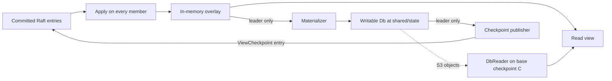

# Shared state: one writer and read-only followers

**Status:** accepted design for an opt-in prototype. Nothing in this document is implemented.
It extends [object storage snapshots](object-snapshots.md) and changes parts of the
[architecture](architecture.md) contract. Source facts are from `b1fc78d` and SlateDB 0.18.1.

## Problem

Each member keeps its own SlateDB under `member-<id>/state`. Each member flushes and compacts the
same data. A three-voter cluster therefore stores three copies of every SST, and it pays three
times for S3 writes, compaction CPU, and compaction I/O. S3 already replicates each object, so
the extra copies add cost but little durability.

A shared SST pool (plan A) removes the copies only at snapshot install. Each member writes new
SSTs after that, so the pool decays back to N copies. This design keeps one copy at all times.

## Goals

1. Store one SST copy for each cluster. Only the leader flushes, compacts, and collects garbage.
2. Keep the Raft contract: a quorum of durable logs commits a write before any S3 upload.
3. Keep follower reads: serializable reads, ReadIndex reads, and Watch on every member.
4. Make a leader change cost no more than today. No member may replay or rescan state for it.
5. Never return wrong data. A missing object can fail a read, but it cannot change a result.

Non-goals: local filesystem storage, cross-bucket members, and online conversion of an existing
cluster. Members on different hosts cannot share a local directory, so local mode keeps the
current design.

## Summary



- Every member applies committed entries as today. The apply output goes to an in-memory
  **overlay**, not to SlateDB.
- A **view** is a read-only SlateDB checkpoint, the member's **base**, plus the overlay above it.
  All reads and all apply-time evaluation use views.
- Only the leader opens a writable `Db` on the shared path. Its **materializer** copies overlay
  batches into the `Db` in order. Client replies do not wait for this copy.
- The leader's **checkpoint publisher** creates one SlateDB checkpoint after each flush. It then
  proposes a `ViewCheckpoint` Raft entry with the checkpoint ID.
- A member that applies `ViewCheckpoint(C)` opens `C` in the background. When `C` is open, it
  becomes the new base, and the member drops the overlay that `C` covers.
- A new leader opens the writable `Db`, which fences the old leader. It then materializes its own
  overlay. It does not replay or rescan.

## Terms

| Term | Meaning |
| --- | --- |
| `F(C)` | The Raft index that checkpoint `C` covers: its `meta/applied` row |
| Base | The checkpoint under a member's current views |
| Overlay | Per-member memory that holds the applied batches above the base |
| View `(C, S)` | Base `C` plus overlay batches in `(F(C), S]`: the state at `S` |
| Materializer | The leader task that writes overlay batches into the shared `Db` |
| Publisher | The leader task that flushes, creates checkpoints, and proposes `ViewCheckpoint` |

## Invariants

The design depends on these rules. Later sections refer to them by number.

1. **Prefix.** The shared `Db` holds the result of entries `1..=last_l0_seq` and nothing else.
   Apply writes one batch at the last index of each group (`put_batch.rs:170-171`). A batch holds
   final row values, so a batch that spans an index is still correct on top of a state below it.
2. **One state writer.** Only the holder of the current writer epoch can commit L0 or compaction
   changes. Checkpoint creation, refresh, and deletion and SlateDB GC also write the manifest
   without an epoch check (`admin.rs:565-626`, `garbage_collector.rs:427-450`). Retention must
   therefore stay safe when a deposed leader runs it.
3. **Equal views.** On every member, view `(C, S)` equals the state after entry `S`. Shared mode
   removes the two per-member inputs to apply (see [Determinism](#determinism)).
4. **Overlay cover.** A member keeps every overlay batch above `F(C)` for each checkpoint `C`
   that a live view uses.
5. **Log cover.** A member truncates its log only through `F(C)` of its base. That checkpoint is
   durable in S3.
6. **Monotonic base.** A member's base `F` never goes down.
7. **Fail closed.** A read that cannot find an object fails. No path substitutes other data.

## Storage layout and mode

```text
<prefix>/<sha256(cluster-id)>/
    shared/owner.json          cluster claim and mode, created with PutMode::Create
    shared/bootstrap.json      written once after the first checkpoint, PutMode::Create
    shared/state/              the one SlateDB: manifest/, compacted/, wal/ fence files
    member-<id>/binding.json   member identity and mode check, no state
```

- The cluster selects `--state-mode shared` at bootstrap. The mode and the quota are stored in
  the claim. Each member's local binding repeats the mode and root. A member with a different
  mode or root refuses to start.
- `shared` requires S3. All members must use the same bucket, endpoint, region, and prefix.
- Every voter needs read and write access to `shared/state/`, because any voter can become the
  leader. Per-member write isolation is lost. See [Costs](#costs-and-trade-offs).
- Scope each voter's credentials to its own cluster prefix. A learner can use read-only
  credentials. Promotion checks write access before the learner can lead.
- A credential that can delete objects can delete the data of every member. Keep recovery
  copies under separate credentials.
- A member refuses to open an existing cluster in a different mode.
- `replicated` stays the default and keeps the current `member-<id>/state-N` layout.

## Bootstrap

1. The first leader creates `shared/state` when it opens the writer.
2. The first leader proposes `SeedMembers` with its membership. Every member stores that row
   when it applies the entry. Until then, each member keeps its bootstrap membership in memory.
3. Before a checkpoint exists, every member uses an empty base. Its overlay starts at index 1,
   and its log holds every entry.
4. The first leader publishes the first checkpoint after its first state batch, the seed. It
   then writes `shared/bootstrap.json`.
5. After `bootstrap.json` exists, a member never starts from an empty base. If it finds no
   checkpoint, it stops with an error. This prevents a replay onto empty state.

## Overlay

The overlay stores the row mutations that apply already builds in `batch::WriteBatch`. It does
not store commands.

- It keeps each apply batch with its sequence: the last index of its group. The materializer
  writes these batches in order.
- For reads, it also keeps ordered maps from `(key, seq)` to `Option<value>`, split into
  **segments**. `None` is a delete. Values are `Bytes`, so the maps share them with the batches.
- A `ViewCheckpoint` entry is not a KV entry, so it ends an apply group. A segment closes at each
  `ViewCheckpoint` entry.
- A segment is released when its whole range is at or below `F` of the oldest checkpoint that a
  live view uses (invariant 4). A group that spans `F` stays until a later base covers it.

**Memory limit.** The overlay is one part of a member memory budget. On the leader the budget
also counts the `Db` memtable and the materializer backlog. `--overlay-max-bytes`, default
1 GiB, is checked only when the leader admits a new proposal. Over the limit, the leader
rejects new client proposals with the existing retryable admission error. `ViewCheckpoint`
proposals are exempt. Apply of committed entries does not wait for this limit. A wait there could
block the very entry that frees the memory. Only the hard limit below pauses apply.

A member over the limit, leader or follower, frees memory in this order:

1. Switch to the newest checkpoint if it is above the base. This releases the covered segments.
2. Cancel the oldest reads and Watch scans that pin an old base, with a retryable error.
   Watch streams resume from their last delivered revision on a new view.
3. If the overlay is still over the hard limit, `2 × --overlay-max-bytes`, pause apply. The
   committed entries stay in the durable log, and Raft continues to persist and acknowledge
   new entries. Reads that wait for apply time out with the existing retryable error.
4. While paused, poll the checkpoint list. Switch out of band to any checkpoint newer than the
   base, including one at or below `applied`, and release the segments it covers. Resume apply
   when the overlay is below `--overlay-max-bytes`. If a checkpoint above `applied` appears,
   [rebase](#rebase) onto it.

Step 3 bounds memory during an S3 stall even when the member already has the newest base.
Step 4 does not need the paused `ViewCheckpoint` entries. A paused leader still materializes its
applied batches, so it publishes a checkpoint at or below its own `applied` and then switches to
it. A test stalls S3 on a single voter, recovers S3, and sends no new requests. The voter must
resume. A second run stalls S3 before the first announcement applies, so the out-of-band switch
must release the open segment.

## Views and reads

A view is `(reader(C), segments, S)`. `reader(C)` is a `DbReader` in
`DbReaderMode::Checkpoint(C)` with `skip_wal_replay = true`. That mode writes no objects and
does not poll (SlateDB `db_reader.rs:53-75`).

- **Point read:** search the segments from newest to oldest for the newest version at or below
  `S`. If none exists, read `reader(C)`.
- **Scan:** merge the segment ranges with the reader scan. An overlay delete hides the reader
  row. The service uses no range deletes, so a key-by-key merge is complete.
- **Pinning:** a view holds `Arc` references to its reader and segments. Apply and base switches
  cannot change it. This replaces the pinned `DbSnapshot` in `ReadView` (`state/read.rs:4-35`).
  A view exists at each group end of the member, not at every index.
- **Apply reads:** apply evaluates each entry against the view at `applied`. This covers point
  reads, lease revoke scans, Auth scans, and compaction step scans. The group overlay
  (`mvcc.rs:943-965`) stays on top for writes inside one group.
- **Background planner:** the compaction planner reads the live `Db` today
  (`state/compaction.rs:190-252`). It must read a view pinned when the plan starts.
- **Caches:** all readers of a member share one SlateDB `DbCache`, so a base switch keeps cached
  blocks. An optional local disk cache can cut S3 reads further.

The key index, quota counter, lease table, Auth, alarms, members, and Watch capture keep their
apply-time updates. They do not depend on SlateDB writes.

## Apply

Apply keeps its order, grouping, and replies. Only the storage target changes:

1. Evaluate the entry or group against the current view.
2. Invalidate the `RowCache` rows for the changed keys, as `state.rs:362-366` does today.
3. Add the batch to the overlay and to the materializer queue.
4. Update the derived state and publish the new view.
5. Reply to waiting clients.

Step 3 replaces `db.write_with_options` in `store_batch` (`state.rs:369`). The early-reply path
(`PublishPuts`, `apply.rs:264-274`) uses the same steps. Replies no longer wait for a SlateDB
memtable insert.

`ViewCheckpoint { checkpoint }` is a new entry type. It closes the open segment and starts a
background open of `reader(checkpoint)`. It changes no etcd state and does not advance the KV
revision. The checkpoint covers only entries below this entry, so the member has applied them.

In shared mode an entry that changes no state writes **no batch**. This covers empty entries and
`ViewCheckpoint`. Today such entries still write `meta/applied`. Here that write would make the
memtable dirty, and the age flush would then publish a checkpoint for it. Each announcement
would cause the next one on an idle cluster. `applied` still advances in memory, and `F` stays
the index of the last state change.

## Determinism

Two inputs to apply could differ by member. With a shared base, a member's view would change
when its base switches. Shared mode removes both inputs:

- **Quota.** Shared mode stores the quota in the cluster claim, and every member reads it from
  there. It ignores the replicated `etcd/quota` row and `SetQuota` entries.
- **Membership.** Only a `SeedMembers` entry and configuration changes write `etcd/members`.
  The bootstrap membership of each member stays in memory. A restore writes the row once in
  the shared database. The cluster claim compares only the voter IDs.

DST must compare every member's view with one reference state to catch any other input.

## Leader: materializer

The materializer runs only on the leader that holds the writer epoch.

1. Read `last = manifest.last_l0_seq` after the writer opens.
2. Wait until `applied >= last`. The entries up to `last` are committed, so apply reaches `last`.
3. For each overlay batch with `seq > last`, in order, call `db.write_with_options(batch,
   seqnum = seq)`. A batch that spans `last` is written whole. Its values are final, so the
   result is correct (invariant 1).
4. Repeat step 3 as apply adds batches.

The materializer may lag apply. The overlay keeps the lagging batches (invariant 4).
A materializer error closes the writer and starts the recovery in
[Leader change](#leader-change-and-fencing).

## Leader: checkpoint publisher

The publisher makes one checkpoint for each flush. The flush rate therefore sets the checkpoint
rate.

1. Flush when the oldest unflushed batch is older than `--view-max-age` (default 10 s). SlateDB
   also flushes on its own when a memtable reaches `l0_sst_size_bytes` (64 MiB). While a
   checkpoint is being published, later flushes join the next publication.
2. When `last_l0_seq` advances, call `create_checkpoint(Durable)` with the name
   `view-<checkpoint-id>`. `Durable` does not force another flush.
3. When the call returns, read `F` from the checkpoint's own `meta/applied`. Do not use the
   `last_l0_seq` read in step 2. A pending L0 commit can land first and raise the real `F`
   (`manifest_writer.rs:401-468`).
4. Propose `ViewCheckpoint { checkpoint }`.
5. Also publish after each configuration change, so a checkpoint holds each new membership.
   This replaces the forced checkpoint after a membership change (`node/schedule.rs:65-66`).

The publisher acts only on progress that a state change made. No-op entries write no batch,
so they never start a flush or a checkpoint. A test writes once and then waits several age
intervals. It must see exactly one checkpoint and one announcement.

An idle cluster makes no new checkpoints. Light writes make one each `--view-max-age`. Heavy
writes make one for each 64 MiB memtable, a flush that also happens today. A checkpoint costs
one manifest write and one small Raft entry.

`--view-max-age` is the main trade-off. A shorter age reduces overlay memory and log retention.
It also makes smaller L0 SSTs and more compaction.

Each batch also writes `meta/applied-term`, the term of its last entry. A checkpoint is
therefore self-describing. Its `meta/applied`, `meta/applied-term`, and `etcd/members` give the
index, term, and ConfState that a Raft snapshot record needs. Take the ConfState from
`etcd/members` in the checkpoint, not from the member's current configuration. The publisher
refuses to announce a checkpoint without `etcd/members`, and install rejects one.

## Checkpoint retention

Checkpoints have **no lifetime**. Only explicit deletion removes them. An idle cluster and a
cluster with no leader therefore keep their checkpoints.

- Each member reports every checkpoint that a live view still pins to the leader on the peer
  stream (`ViewAck`). A long read or Watch scan on an old view therefore keeps its checkpoint.
- A view can pin a checkpoint for at most `--view-pin-max` (default 5 minutes). After that the
  read fails with a retryable error, and a Watch stream resumes from its last delivered revision
  on a new view.
- The publisher keeps the two newest checkpoints and every checkpoint that a member reported in
  the last 10 minutes. It deletes the rest.
- A member that has not reported for 10 minutes loses this protection. It can then hit a missing
  SST and [rebase](#rebase).
- Before each deletion, the publisher reads the manifest and checks that it still holds the
  writer epoch. A deposed leader can still race this check (invariant 2). Its worst result is a
  rebase on a lagging member.
- `list_checkpoints` matches names exactly (`admin.rs:262-290`). The publisher lists all
  checkpoints and filters the `view-` prefix itself. It never deletes the compactor's
  checkpoints.

## Base switch

1. Apply `ViewCheckpoint(C)`. Close the segment. Start `DbReader::open(Checkpoint(C))` in the
   background. Apply continues.
2. When the reader is open, read `F(C)`. If `F(C)` is not above the current base, close the
   reader and stop (invariant 6). Opens can finish out of order. Then warm the cache for at
   most 500 ms. See [Base cache warm](#base-cache-warm).
3. Publish later views as `(reader(C), segments above F(C))`. Report `C` in `ViewAck`.
4. When no view uses the old reader, close it and release the segments at or below `F(C)`.
5. Write a Raft snapshot record for `C` and allow log truncation through `F(C)` (invariant 5).

A failed open does not change the current base. The member keeps its view and overlay, and it
waits for the next checkpoint.

### Base cache warm

A replicated member caches SST indexes, filters, and `etcd/current/` blocks when it flushes an L0
SST. SlateDB also caches the index and filters of compaction output. A shared-mode member writes
no SST, so every first read of a block in a new base was an S3 GET.

A member therefore loads the same entries with `DbReader::warm_sst` when it adopts an announced
base, before the switch. L0 SSTs get indexes, filters, and `etcd/current/` blocks. Sorted run SSTs
get indexes and filters. The cost is one GET per contiguous range of current-row blocks in each
new L0 SST, on each member. These rules apply:

- The warm stops after 500 ms, and the member then switches. A slow store cannot hold back a
  usable base while the overlay grows.
- An SST counts as warm only after all its entries loaded. A failed or stopped warm leaves the SST
  for the next base.
- The set of warm SSTs keeps only SSTs of live bases, so it does not grow with each flush.
- A publication, a snapshot receipt, a restart, and a manual apply such as DST open a base with no
  warm. They do not wait for SST reads.

Benchmark note: three members on one host with MinIO, 100,000 preloaded keys of 256 B, 64
clients. Before this step, followers missed 41% of their data block lookups. Linearizable random
reads ran at 11,300 ops/s with a p99 of 59 ms, and replicated mode at 27,400 ops/s with a p99 of
5.5 ms. With this step, followers missed none. Linearizable reads ran at 29,400 ops/s with a p99
of 5.1 ms, and serializable reads at 32,800 ops/s with a p99 of 4.6 ms. Before this step, a
second pass on the same cluster already ran at 24,600 ops/s. So cold blocks were the cause, not
the cost of the overlay or the base reader.

Each follower now downloads about the current-row bytes of every write once. In a run of
100,000 puts of 256 B (put-c256), cluster-wide S3 GET response bytes rose from 2.5 MiB to
45.3 MiB during the load, and from 1.9 MiB to 25.9 MiB while it settled: a 15 s pause and a
checkpoint on each member. The total rose from 4.4 MiB to 71.2 MiB. The GET count did not
change.
After a Defragment or another compaction, both modes read cold compaction output. In the same
setup, one read pass then ran at about 9,500 ops/s in both modes.

## Rebase

A member rebases when its overlay is over the limit, or when a read or apply step finds a
missing SST. Today a storage error in apply stops the node (`node/apply.rs:507-670`). In shared
mode a missing SST rebases the member instead. Every other storage error still stops the node.

1. Stop apply and fail pending local reads with a retryable error.
2. Open the newest `view-` checkpoint `C`.
3. [Install](#install) `C`: a local rebuild if `F(C) <= applied`, otherwise an adopt.
4. Resume apply above the new `applied`.

A rebase rescans the live data. It is the cost of losing a base, not of a leader change.

## Log truncation and Raft snapshots

- Today a member flushes its own SlateDB and then truncates (`storage.rs:347-409`). In shared
  mode a member never flushes. It truncates through `F` of its base after step 5 of the switch.
  The existing `snapshot_every` and `snapshot_min_bytes` rules still choose when.
- The Raft snapshot data becomes descriptor format 6: `{ checkpoint }`. The record metadata holds
  the index, term, and ConfState from the checkpoint. `Storage::snapshot` returns the newest
  checkpoint at once. It builds no image.
- **Receive:** the HTTP handler opens `reader(C)` before it steps `MsgSnapshot` into Raft, as
  today's handler copies objects first (`api.rs:103-117`). A failed open fails the request, and
  Raft retries. The handler keeps the reader until the install finishes, and the member reports
  `C` in `ViewAck`.

## Install

Install sets a member's base to checkpoint `C` and drops its overlay. It has two forms. They
differ in whether the Raft log changes.

**Common steps:**

1. Build the derived state from `reader(C)`. This is a reader variant of
   `StateMachine::open_at` (`state.rs:253-269`). It makes a new `RowCache`, invalidates the Watch
   capture, and clears the compaction plan.
2. Load the quota counters from `meta/logical-size`, which each batch writes with the apply
   marker, so install does not scan every `etcd/` row. The batch also writes the eight-byte total
   to `meta/logical-bytes` for older readers. A base from an older binary has no counter row that
   matches its apply marker, so install counts the rows once (`state/maintenance.rs`).

**Local rebuild, `F(C) <= applied`.** Rebase and restart use this form. The Raft log does not
change.

- Set the state to `F(C)` and replay the local log from `F(C) + 1` to the old `applied`.
- Hold reads and Watch behind a barrier until the replay reaches the old `applied`. The barrier
  keeps a client from seeing state older than a result it already has.
- Watch capture drops the replayed events at or below the last published revision, so no stream
  gets an event twice.

**Adopt ahead of the log, `F(C) > applied`.** A received Raft snapshot, a paused member, and a
restart with a short log use this form. It follows the Raft snapshot restore rules:

- If the local log holds an entry at `F(C)` with the checkpoint term, keep the entries after it
  and keep the local commit index when it is higher. Then replay through that commit index.
- If the term at `F(C)` differs and `F(C)` is above the local commit index, discard the whole log.
  An entry above a mismatched `F(C)` can come from a deposed term and has lost its prefix.
- If the term differs and `F(C)` is at or below the local commit index, two committed prefixes
  disagree. Stop recovery with an error.
- Persist the snapshot record, its ConfState, the new commit index `max(commit, F(C))`, and the
  log change in one synced raft-engine batch. A crash leaves either the old log or the new
  boundary.
- `F(C)` is committed, because only committed entries reach the shared `Db`.

A test crashes the member right after the adopt batch and then forces an election. The member
must not vote with, or replicate, a discarded entry. A second test adopts checkpoint 100 with
`applied = 90` and commit 110, crashes, and checks that 101–110 are still committed on restart.

`KeyIndex::load` reads current rows with their values (`state/key_index.rs:82-90`). Install
time therefore grows with the live data size. It does not grow with history or SST count.

## Leader change and fencing

**Become leader at term `t`:**

1. Apply continues into the overlay. Reads and replies continue.
2. Open the writable `Db` on `shared/state`. The open increments the writer epoch, which fences
   the old writer (SlateDB `manifest/store.rs:36-51`).
3. When the open completes, check that the member is still the leader at term `t`. If not,
   close the `Db`.
4. Wait until the local clock passes the manifest's `last_l0_clock_tick`. See
   [Clocks](#clocks).
5. Start the materializer and the publisher.

Client writes do not wait for steps 2–4. Proposals commit to the log and apply to the overlay at
once. A slow S3 open grows the overlay until the memory limits apply. The failover test in
[Tests](#tests) must confirm that the first write succeeds after one election.

**What the old leader can still do after the fence:**

- It can insert into its own memtable and upload an L0 SST. The SST is an orphan, because the
  old leader cannot commit a manifest (manifest IDs use CAS). GC removes the orphan later.
- If its manifest write lands before the fence, the new writer inherits that L0. Then
  `last_l0_seq` can be above the new leader's `applied`. Step 2 of the materializer waits for
  that. The entries are committed, so apply reaches them.
- A `ViewCheckpoint` that it proposed can still commit. Its checkpoint is a valid durable state,
  and the base switch ignores it if it is not newer (invariant 6).

**Fenced while still the leader:** two quick elections can fence a current leader. The open for
term `t + 1` can complete after the open for term `t + 2`. A `Fenced` error is then expected,
not a storage failure. If the member is still the leader, it opens the `Db` again and restarts
the materializer from the new `last_l0_seq`. The overlay covers everything above the base, and
`last_l0_seq` is at or above every published checkpoint, so the overlay covers what the
materializer needs. Architecture rule 8, "stop the node after a state storage failure", keeps
its meaning for every other error.

**Step down:** stop the publisher, stop the materializer, and close the `Db` without a flush.
The member already has a view, so it changes nothing else. Leader transfer first flushes and
publishes one checkpoint. This makes the overlays on all members smaller.

The compactor and GC run inside the writer `Db`. The new writer's compactor takes a new
compactor epoch, which fences the old compactor. GC has no epoch. The old process closes its GC
when it closes the `Db`.

## Clocks

Shared mode makes SlateDB use clocks from several hosts. Replicated mode never does.

- A writer starts its monotonic clock at the manifest's `last_l0_clock_tick` (`db.rs:150-153`).
  If the new leader's clock is behind, each write sleeps up to 10 s and then fails with
  `InvalidClockTick` (`clock.rs:53-83`). Step 4 of the leader change waits instead.
- GC compares SST ID times with its own clock. Its guards are the newest L0 and the compaction
  low watermark (`compacted_gc.rs:200-232`). Large skew can move these guards.

The service exports the skew against `last_l0_clock_tick` as a metric. It refuses to start the
writer when the skew is over `--max-clock-skew` (default 5 s), and it reports an alarm.

## Restart

1. Read the base from the local Raft snapshot record. If that checkpoint was deleted, take the
   newest `view-` checkpoint. If none exists and `bootstrap.json` exists, stop with an error.
2. [Install](#install) the base. If the local log ends below `F` or its term at `F` differs,
   this is an adopt. Otherwise it is a local rebuild with nothing to replay yet.
3. Replay committed log entries above `F` into the overlay. This is the current replay path with
   the overlay as its target.

## Operations

| Operation | Shared mode behavior |
| --- | --- |
| Physical Compact | Steps apply to each overlay. The reply waits for a covering checkpoint |
| Defragment | Leader only, because it needs the writer and compactor. Followers forward it |
| Status `db_size` | Read from the view's manifest. All members report the same value |
| HashKV and Hash | Computed from the view, as today from the local `Db` |
| Backup export | Scan a view. It needs no flush, so any member can export |
| Alarms and quota | Unchanged. The counter and the quota are cluster-wide |

## Failure cases

| Case | Result |
| --- | --- |
| Leader crashes with unflushed batches | The new leader materializes them from its overlay |
| Old leader is partitioned | It cannot commit L0 changes. Its uploads are orphans |
| S3 is slow or down | New proposals fail at the soft limit. Apply pauses at the hard limit |
| A member stops reporting its base | Its base can be deleted. It rebases on a missing SST |
| A checkpoint open fails | The member keeps its base and tries the next checkpoint |
| No writes for a long time | Checkpoints have no lifetime, so all bases stay valid |
| No leader for a long time | No process deletes anything |
| All members restart | Each member installs its base and replays its log |
| Writer opens in reverse term order | The current leader is fenced, then it opens again |
| New leader's clock is behind | The writer waits, or refuses over the skew limit |
| The shared `Db` is lost or corrupted | All members lose state together. Restore from a backup |

## Costs and trade-offs

- **Storage and S3 writes:** one copy of each SST, and one member's flush and compaction PUTs.
  Followers do no SlateDB writes, flushes, or compactions.
- **Follower memory:** the overlay holds at most `--view-max-age` of writes or about one 64 MiB
  memtable, plus any upload backlog. This is near the leader's unflushed data today.
- **Leader memory:** the leader holds the overlay and the `Db` memtable. `Bytes` sharing removes
  most of the value copy. This must be measured before release.
- **Snapshot install:** no data copy. It reads the live rows to rebuild the key index.
- **Follower S3 reads:** each member reads the indexes, filters, and current-row blocks of each
  new L0 SST once, at its base switch. This adds few GET requests but about the current-row
  bytes of all writes. A replicated member gets the same entries from its own flush.
- **Fault domain:** members no longer hold independent copies. A writer bug or an object loss
  affects all members. HashKV can still detect divergent apply, but not storage corruption.
- **Isolation:** every voter can write the shared prefix.
- **Clocks:** leader changes depend on bounded clock skew between hosts.
- **Two code paths:** local mode keeps the replicated design. Both need tests.

## Alternatives considered

- **Plan A, a shared SST pool:** removes copies only at install. The copies return after
  compaction.
- **`DbReaderMode::ManagedCheckpoint`:** every follower writes the leader manifest on every
  poll. A poll error also closes the reader for good (SlateDB `db_reader.rs:561-625, 774-786`).
- **`DbReaderMode::FollowLatest`:** no GC protection. A follower can read a deleted SST.
- **Followers without state:** forwarded writes wait for local apply
  (`grpc/forwarding.rs:82-127`), and followers serve reads and Watch. Sending all of that to the
  leader moves the read load and Watch fan-out to one member.
- **Leader writes `Db` only, without an overlay:** a fence or a step-down then needs the derived
  state at `last_l0_seq`. That costs a full rescan on each leader change.

## Rollout

| Phase | Change | Behavior change |
| --- | --- | --- |
| 0 | Read trait over `DbSnapshot`, `WriteBatch` access, `meta/applied-term` | None |
| 1 | Overlay, views, materializer, publisher, bootstrap on one voter | New mode only |
| 2 | Base switch, `ViewAck`, retention, install, rebase, format 6, restart | New mode only |
| 3 | Writer open, fencing, reopen, clock checks, and step-down | New mode only |
| 4 | Operations, metrics, docs, benchmarks, then an offline converter | New mode only |

## Tests

- **DST:** share one in-memory object store between members. Add leader changes at each
  materializer and publisher step, two writers in reverse term order, and crashes before and
  after each checkpoint. Delete checkpoints under a lagging member. Finish base opens out of
  order. Fill the overlay on the leader and on a follower.
- **Feedback loop:** write once, then wait several `--view-max-age` intervals. Exactly one
  checkpoint and one announcement must appear.
- **Pinned reads:** hold a range read and a Watch catch-up open across several base switches and
  GC runs. The read must succeed or fail with a retryable error. The Watch must resume with no
  gap and no duplicate.
- **S3 stall:** stall S3 under write load with one old view pinned. Measure peak memory, check
  the pause, and check recovery after S3 returns.
- **Adopt and crash:** adopt a checkpoint above a conflicting log suffix, crash, and force an
  election. Also restart three voters after the first checkpoint with no membership change.
- **Idle and leaderless runs:** stop writes, or stop all voters, for longer than every retention
  window. Then restart members and add a learner.
- **Clocks:** skew host clocks in DST. Check the writer wait, the skew limit, and GC.
- **Invariants in DST:** each member's view at `S` equals a reference state at `S`, and HashKV
  agrees on all members. No read returns a value that the reference does not hold.
- **Integration:** three members on RustFS or MinIO. Run the linearizability checks during kill,
  partition, and leader-transfer schedules.
- **Benchmarks:** compare replicated and shared mode on `lai7-8c32`. Measure S3 bytes, S3 PUTs,
  follower and leader peak RSS, snapshot install time, and read p99.
- **Failover:** measure the time to the first successful write after an election with a nearly
  full overlay. Do not claim one-election failover before this passes.
- **View age:** compare 10 s and 30 s under light writes and bursts. Choose the release default
  from follower peak memory, retained log bytes, S3 requests, compaction bytes, and write p99.
- **Recovery:** restore a cluster after loss of the shared prefix at the target data size. The
  native backup limit is 64 MiB today, so production use needs a larger backup path.

## Decisions

Sig-Codex recommended these answers, and siddontang accepted them on 2026-11-24.

1. **Leader memory:** accept about 2× the unflushed data for the prototype. Slow uploads, queued
   writes, and long reads can retain more, so enforce a total memory budget and measure peak RSS.
2. **View age:** start with a 10 s maximum age for dirty data, with no timer work when idle.
   Choose the release default from the 10 s and 30 s comparison in [Tests](#tests).
3. **Scope:** shared mode for new clusters only in the first release. Replicated mode stays the
   default.
4. **Write access:** all voters of one trusted cluster share write access, with the credential
   rules in [Storage layout and mode](#storage-layout-and-mode).

## Appendix: SlateDB 0.18.1 facts

Paths are under `slatedb-0.18.1/src`.

- `WriteOptions.seqnum` sets the batch sequence. It must be above the last sequence:
  `config.rs:543-552`, `batch_write.rs:211-220`.
- A writer opens at `manifest.last_l0_seq`. With the WAL off, unflushed data is lost:
  `db.rs:141-147`.
- A writer's clock starts at `last_l0_clock_tick`. A lagging clock fails writes:
  `db.rs:150-153`, `clock.rs:53-83`.
- `DbReaderMode::Checkpoint` stays fixed and writes nothing. `skip_wal_replay` skips WAL reads:
  `db_reader.rs:53-75, 288-294, 524-526`.
- `DbReader` has no forced refresh and no read at a sequence: `db_reader.rs:345, 1073-1500`.
- A missing SST fails the read with no retry: `slatedb-common retry.rs:46-56`,
  `error.rs:695-701`.
- GC keeps SSTs that the latest manifest or a checkpoint references. Its time guards are the
  newest L0 and the compaction low watermark: `garbage_collector/compacted_gc.rs:200-256`.
- GC removes expired checkpoints: `garbage_collector.rs:427-450`.
- Opening a writer increments the epoch with a manifest CAS. The old writer gets
  `Closed(Fenced)`: `manifest/store.rs:36-51`, `manifest_writer.rs:751-787`.
- Checkpoint refresh and deletion write the manifest with no epoch check: `admin.rs:565-626`.
- The L0 uploader has no epoch check, so a fenced writer can leave orphan SSTs:
  `memtable_flusher/uploader.rs:210-230`.
- The compactor has its own epoch: `manifest/store.rs:53-67`.
- With the WAL off there is no time-based flush. A memtable freezes at `l0_sst_size_bytes`:
  `batch_write.rs:317-352`.
- `create_checkpoint` takes a scope, lifetime, and name. `Durable` does not flush:
  `checkpoint.rs:118-147`, `config.rs:668-690`. The checkpoint's sequence is fixed when the
  flusher handles the request: `manifest_writer.rs:401-468`.
- `list_checkpoints` filters by exact name: `admin.rs:262-290`.
