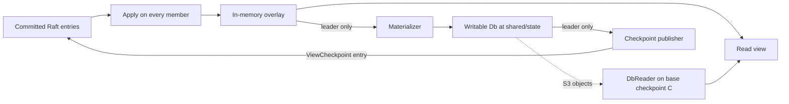

# Shared state: one writer and read-only followers

**Status:** accepted design for an opt-in prototype. Nothing in this document is implemented.
It extends [object storage snapshots](object-snapshots.md) and changes parts of the
[architecture](architecture.md) contract. Source facts are from `b1fc78d` and SlateDB 0.18.1.

## Problem

Each member keeps its own SlateDB under `member-<id>/state`. Each member flushes and compacts the
same data. A three-voter cluster therefore stores three copies of every SST, and it pays three
times for S3 writes, compaction CPU, and compaction I/O. S3 already replicates each object, so
the extra copies add cost but little durability.

A shared SST pool (plan A) removes the copies only at snapshot install. Each member writes new
SSTs after that, so the pool decays back to N copies. This design keeps one copy at all times.

## Goals

1. Store one SST copy for each cluster. Only the leader flushes, compacts, and collects garbage.
2. Keep the Raft contract: a quorum of durable logs commits a write before any S3 upload.
3. Keep follower reads: serializable reads, ReadIndex reads, and Watch on every member.
4. Make a leader change cost no more than today. No member may replay or rescan state for it.
5. Never return wrong data. A missing object can fail a read, but it cannot change a result.

Non-goals: local filesystem storage, cross-bucket members, and online conversion of an existing
cluster. Members on different hosts cannot share a local directory, so local mode keeps the
current design.

## Summary



- Every member applies committed entries as today. The apply output goes to an in-memory
  **overlay**, not to SlateDB.
- A **view** is a read-only SlateDB checkpoint, the member's **base**, plus the overlay above it.
  All reads and all apply-time evaluation use views.
- Only the leader opens a writable `Db` on the shared path. Its **materializer** copies overlay
  batches into the `Db` in order. Client replies do not wait for this copy.
- The leader's **checkpoint publisher** creates one SlateDB checkpoint after each flush. It then
  proposes a `ViewCheckpoint` Raft entry with the checkpoint ID.
- A member that applies `ViewCheckpoint(C)` opens `C` in the background. When `C` is open, it
  becomes the new base, and the member drops the overlay that `C` covers.
- A new leader opens the writable `Db`, which fences the old leader. It then materializes its own
  overlay. It does not replay or rescan.

## Terms

| Term | Meaning |
| --- | --- |
| `F(C)` | The Raft index that checkpoint `C` covers: its `meta/applied` row |
| Covered index | The applied index through which a member's stored batches are the whole state |
| Coverage | The index through which an announcement certifies that `C` is the whole state |
| Base | The checkpoint under a member's current views |
| Base index | The index through which the base is the member's whole state, `F(C)` or more |
| Overlay | Per-member memory that holds the applied batches above the base |
| View `(C, S)` | Base `C` plus overlay batches in `(F(C), S]`: the state at `S` |
| Materializer | The leader task that writes overlay batches into the shared `Db` |
| Publisher | The leader task that flushes, creates checkpoints, and proposes `ViewCheckpoint` |

## Invariants

The design depends on these rules. Later sections refer to them by number.

1. **Prefix.** The shared `Db` holds the result of entries `1..=last_l0_seq` and nothing else.
   Apply writes one batch at the last index of each group (`put_batch.rs:170-171`). A batch holds
   final row values, so a batch that spans an index is still correct on top of a state below it.
2. **One state writer.** Only the holder of the current writer epoch can commit L0 or compaction
   changes. Checkpoint creation, refresh, and deletion and SlateDB GC also write the manifest
   without an epoch check (`admin.rs:565-626`, `garbage_collector.rs:427-450`). Retention must
   therefore stay safe when a deposed leader runs it.
3. **Equal views.** On every member, view `(C, S)` equals the state after entry `S`. Shared mode
   removes the two per-member inputs to apply (see [Determinism](#determinism)).
4. **Overlay cover.** A member keeps every overlay batch above `F(C)` for each checkpoint `C`
   that a live view uses.
5. **Log cover.** A member truncates its log only through its base index. That checkpoint is
   durable in S3.
6. **Monotonic base.** A member's base index never goes down.
7. **Fail closed.** A read that cannot find an object fails. No path substitutes other data.

## Storage layout and mode

```text
<prefix>/<sha256(cluster-id)>/
    shared/owner.json          cluster claim, mode, and store ID, created with PutMode::Create
    shared/bootstrap.json      written once after the first checkpoint, PutMode::Create
    shared/state/              the one SlateDB: manifest/, compacted/, wal/ fence files
    member-<id>/binding.json   member identity and mode check, no state
```

- The cluster selects `--state-mode shared` at bootstrap. The mode and the quota are stored in
  the claim. Each member's local binding repeats the mode and root. A member with a different
  mode or root refuses to start.
- `shared` requires S3. All members must use the same bucket, endpoint, region, and prefix.
  Members send the store ID of the claim with their peer traffic. A member refuses peer traffic
  with another ID or no ID, so members on different stores form no quorum. A shared member
  serves no snapshot objects to peers. Its local binding records the ID, so a restart refuses a
  replaced store.
- Every voter needs read and write access to `shared/state/`, because any voter can become the
  leader. Per-member write isolation is lost. See [Costs](#costs-and-trade-offs).
- Scope each voter's credentials to its own cluster prefix. A learner can use read-only
  credentials. Promotion checks write access before the learner can lead.
- A credential that can delete objects can delete the data of every member. Keep recovery
  copies under separate credentials.
- A member refuses to open an existing cluster in a different mode.
- `replicated` stays the default and keeps the current `member-<id>/state-N` layout.

## Bootstrap

1. The first leader creates `shared/state` when it opens the writer.
2. The first leader proposes `SeedMembers` with its membership. Every member stores that row
   when it applies the entry. Until then, each member keeps its bootstrap membership in memory.
3. Before a checkpoint exists, every member uses an empty base. Its overlay starts at index 1,
   and its log holds every entry.
4. The first leader publishes the first checkpoint after its first state batch, the seed. It
   then writes `shared/bootstrap.json`.
5. After `bootstrap.json` exists, a member never starts from an empty base. If it finds no
   checkpoint, it stops with an error. This prevents a replay onto empty state.

## Overlay

The overlay stores the row mutations that apply already builds in `batch::WriteBatch`. It does
not store commands.

- It keeps each apply batch with its sequence: the last index of its group. The materializer
  writes these batches in order.
- For reads, it also keeps ordered maps from `(key, seq)` to `Option<value>`, split into
  **segments**. `None` is a delete. Values are `Bytes`, so the maps share them with the batches.
- A `ViewCheckpoint` entry is not a KV entry, so it ends an apply group. A segment closes at each
  `ViewCheckpoint` entry.
- A segment is released when its whole range is at or below `F` of the oldest checkpoint that a
  live view uses (invariant 4). A group that spans `F` stays until a later base covers it.

**Memory limit.** The overlay is one part of a member memory budget. On the leader the budget
also counts the `Db` memtable and the materializer backlog. `--overlay-max-bytes`, default
1 GiB, is checked only when the leader admits a new proposal. Over the limit, the leader
rejects new client proposals with the existing retryable admission error. `ViewCheckpoint`
proposals are exempt. Apply of committed entries does not wait for this limit. A wait there could
block the very entry that frees the memory. Only the hard limit below pauses apply.

A member over the limit, leader or follower, frees memory in this order:

1. Switch to the newest checkpoint if it is above the base. This releases the covered segments.
2. Cancel the oldest reads and Watch scans that pin an old base, with a retryable error.
   Watch streams resume from their last delivered revision on a new view.
3. If the overlay is still over the hard limit, `2 × --overlay-max-bytes`, pause apply. The
   committed entries stay in the durable log, and Raft continues to persist and acknowledge
   new entries. Reads that wait for apply time out with the existing retryable error.
4. While paused, poll the checkpoint list. Switch out of band to any checkpoint newer than the
   base, including one at or below `applied`, and release the segments it covers. Resume apply
   when the overlay is below `--overlay-max-bytes`. If a checkpoint above `applied` appears,
   [rebase](#rebase) onto it.

Step 3 bounds memory during an S3 stall even when the member already has the newest base.
Step 4 does not need the paused `ViewCheckpoint` entries. A paused leader still materializes its
applied batches, so it publishes a checkpoint at or below its own `applied` and then switches to
it. A test stalls S3 on a single voter, recovers S3, and sends no new requests. The voter must
resume. A second run stalls S3 before the first announcement applies, so the out-of-band switch
must release the open segment.

## Views and reads

A view is `(reader(C), segments, S)`. `reader(C)` is a `DbReader` in
`DbReaderMode::Checkpoint(C)` with `skip_wal_replay = true`. That mode writes no objects and
does not poll (SlateDB `db_reader.rs:53-75`).

- **Point read:** search the segments from newest to oldest for the newest version at or below
  `S`. If none exists, read `reader(C)`.
- **Scan:** merge the segment ranges with the reader scan. An overlay delete hides the reader
  row. The service uses no range deletes, so a key-by-key merge is complete.
- **Pinning:** a view holds `Arc` references to its reader and segments. Apply and base switches
  cannot change it. This replaces the pinned `DbSnapshot` in `ReadView` (`state/read.rs:4-35`).
  A view exists at each group end of the member, not at every index.
- **Apply reads:** apply evaluates each entry against the view at `applied`. This covers point
  reads, lease revoke scans, Auth scans, and compaction step scans. The group overlay
  (`mvcc.rs:943-965`) stays on top for writes inside one group.
- **Background planner:** the compaction planner reads the live `Db` today
  (`state/compaction.rs:190-252`). It must read a view pinned when the plan starts.
- **Caches:** all readers of a member share one SlateDB `DbCache`, so a base switch keeps cached
  blocks. An optional local disk cache can cut S3 reads further.

The key index, quota counter, lease table, Auth, alarms, members, and Watch capture keep their
apply-time updates. They do not depend on SlateDB writes.

## Apply

Apply keeps its order, grouping, and replies. Only the storage target changes:

1. Evaluate the entry or group against the current view.
2. Invalidate the `RowCache` rows for the changed keys, as `state.rs:362-366` does today.
3. Add the batch to the overlay and to the materializer queue.
4. Update the derived state and publish the new view.
5. Reply to waiting clients.

Step 3 replaces `db.write_with_options` in `store_batch` (`state.rs:369`). The early-reply path
(`PublishPuts`, `apply.rs:264-274`) uses the same steps. Replies no longer wait for a SlateDB
memtable insert.

`ViewCheckpoint { checkpoint, covers }` is a new entry type. It closes the open segment and
starts a background open of `reader(checkpoint)`. It changes no etcd state and does not advance
the KV revision. The checkpoint covers only entries below this entry, so the member has applied
them.

`covers` is the **coverage**: the leader certifies that the checkpoint is the whole state at each
index from `F` through `covers`. The leader reads `pushed` and the covered index from one
applied state. It sets `covers` to its covered index only when no batch of its own is above
`F`, materialized or not. Otherwise `covers` is `F`. An entry of an earlier binary has no
`covers`, which means `F`. An announcement of the current base only raises its coverage, so it
opens nothing and creates no checkpoint. The coverage belongs to the checkpoint ID. Another
checkpoint at the same `F`, such as a Defragment output, does not get it.

In shared mode an entry that changes no state writes **no batch**. This covers empty entries and
`ViewCheckpoint`. Today such entries still write `meta/applied`. Here that write would make the
memtable dirty, and the age flush would then publish a checkpoint for it. Each announcement
would cause the next one on an idle cluster. `applied` still advances in memory, and `F` stays
the index of the last state change.

The overlay therefore keeps two positions. `pushed` is the index of the newest batch. The
**covered index** is the applied index through which the stored batches are the whole state.
An entry without a batch advances only the covered index. A view and a base switch use the
covered index. The materializer and the publication targets use `pushed`.

Members group entries in different ways. One member can store a batch at 2 for a Put at 1 and a
failed update at 2. Another member stores a batch at 1 and none at 2. Both states at 2 are
equal, so either member can use a checkpoint of the other.

## Determinism

Two inputs to apply could differ by member. With a shared base, a member's view would change
when its base switches. Shared mode removes both inputs:

- **Quota.** Shared mode stores the quota in the cluster claim, and every member reads it from
  there. It ignores the replicated `etcd/quota` row and `SetQuota` entries.
- **Membership.** Only a `SeedMembers` entry and configuration changes write `etcd/members`.
  The bootstrap membership of each member stays in memory. A restore writes the row once in
  the shared database. The cluster claim compares only the voter IDs.

DST must compare every member's view with one reference state to catch any other input.

## Leader: materializer

The materializer runs only on the leader that holds the writer epoch.

1. Read `last = manifest.last_l0_seq` after the writer opens.
2. Wait until `applied >= last`. The entries up to `last` are committed, so apply reaches `last`.
3. For each overlay batch with `seq > last`, in order, call `db.write_with_options(batch,
   seqnum = seq)`. A batch that spans `last` is written whole. Its values are final, so the
   result is correct (invariant 1).
4. Repeat step 3 as apply adds batches.

The task waits past its own position, the higher of `last` and the last released index, not
past `last_l0_seq`. A released batch is in the base, so the task skips it and sleeps until a
later batch arrives. The physical sequence stays where the writes left it, and publications
take their checkpoint row from it.

The materializer may lag apply. The overlay keeps the lagging batches (invariant 4).
A materializer error closes the writer and starts the recovery in
[Leader change](#leader-change-and-fencing).

## Leader: checkpoint publisher

The publisher makes one checkpoint for each flush. The flush rate therefore sets the checkpoint
rate.

1. Flush when the oldest unflushed batch is older than `--view-max-age` (default 10 s). SlateDB
   also flushes on its own when a memtable reaches `l0_sst_size_bytes` (64 MiB). While a
   checkpoint is being published, later flushes join the next publication.
2. When `last_l0_seq` advances, call `create_checkpoint(Durable)` with the name
   `view-<checkpoint-id>`. `Durable` does not force another flush.
3. When the call returns, read `F` from the checkpoint's own `meta/applied`. Do not use the
   `last_l0_seq` read in step 2. A pending L0 commit can land first and raise the real `F`
   (`manifest_writer.rs:401-468`).
4. Propose `ViewCheckpoint { checkpoint }`.
5. Also publish after each configuration change, so a checkpoint holds each new membership.
   This replaces the forced checkpoint after a membership change (`node/schedule.rs:65-66`).

The publisher acts only on progress that a state change made. No-op entries write no batch,
so they never start a flush or a checkpoint. A test writes once and then waits several age
intervals. It must see exactly one checkpoint and one announcement.

An idle cluster makes no new checkpoints. Light writes make one each `--view-max-age`. Heavy
writes make one for each 64 MiB memtable, a flush that also happens today. A checkpoint costs
one manifest write and one small Raft entry.

`--view-max-age` is the main trade-off. A shorter age reduces overlay memory and log retention.
It also makes smaller L0 SSTs and more compaction.

Each batch also writes `meta/applied-term`, the term of its last entry. A checkpoint is
therefore self-describing. Its `meta/applied`, `meta/applied-term`, and `etcd/members` give the
index, term, and ConfState that a Raft snapshot record needs. Take the ConfState from
`etcd/members` in the checkpoint, not from the member's current configuration. The publisher
refuses to announce a checkpoint without `etcd/members`, and install rejects one.

## Checkpoint retention

Checkpoints have **no lifetime**. Only explicit deletion removes them. An idle cluster and a
cluster with no leader therefore keep their checkpoints.

- Each member reports every checkpoint that a live view still pins to the leader on the peer
  stream (`ViewAck`). A long read or Watch scan on an old view therefore keeps its checkpoint.
- A view can pin a checkpoint for at most `--view-pin-max` (default 5 minutes). After that the
  read fails with a retryable error, and a Watch stream resumes from its last delivered revision
  on a new view. A native backup is the one exception. See [Backups](#backups).
- The publisher keeps the two newest checkpoints and every checkpoint that a member reported in
  the last 10 minutes. It deletes the rest.
- A member that has not reported for 10 minutes loses this protection. It can then hit a missing
  SST and [rebase](#rebase).
- Before each deletion, the publisher reads the manifest and checks that it still holds the
  writer epoch. A deposed leader can still race this check (invariant 2). Its worst result is a
  rebase on a lagging member.
- `list_checkpoints` matches names exactly (`admin.rs:262-290`). The publisher lists all
  checkpoints and filters the `view-` prefix itself. It never deletes the compactor's
  checkpoints.

## Backups

A native backup (`Maintenance.Snapshot`) streams the image of one view. It creates no checkpoint.

1. Apply pins the view at the covered index: the base and the overlay segments. It reads the
   revision and the membership in memory. It then returns the stream at once.
2. A task reads the view twice. The first pass counts the rows and checks that each row has at
   most 64 MiB, before the first message. The second pass sends the rows in 64 KiB messages.
3. The task reads the base through a reader of its own, without the member cache and with the
   bounded retries of the member's database. A missing SST ends the stream with Unavailable.
4. The pinned base keeps its checkpoint in `ViewAck`, so retention keeps it.

The image holds the same bytes as the image of the pinned view in memory, plus its digest. It
leaves out the derived rows and the cluster quota row, and it ends with the padded membership row.

A backup view is exempt from `--view-pin-max`, because a large image streams for longer. Instead,
the stream ends with Unavailable when the client takes no message for 60 s. The first pass does
not count as idle time.

A slow backup keeps the segments that later base switches release. Each member bounds this:

- At most 4 backups stream at one time.
- A segment counts against `--overlay-max-bytes` only after the overlay released it, at a base
  switch or a rebase. The overlay already counts the other segments. So a backup of a full
  overlay, as when the writer is down, can start. A segment that several backups keep counts once.
- A new backup fails with ResourceExhausted at 4 streams or while the count is above the limit.
  Retry it later.
- When released segments raise the count above the limit, the oldest backup ends with
  Unavailable (`backup too slow`). It ends also when its client has unread messages, and the
  client reads the error first. It keeps its place and its count until its task drops the view,
  so later checks end no other backup for the same bytes.
- The member keeps these limits across a base adoption, a rebase, and a snapshot install.
- This budget does not change the write admission of the leader.

The merge of a view searches the segments from the oldest to the newest. A newer segment
replaces an equal key. So a scan skips each key of the open segment above its sequence once.
Scans and backups yield to the runtime every few hundred steps, also in a long run of deletes.

## Base switch

1. Apply `ViewCheckpoint(C)`. Close the segment. Start `DbReader::open(Checkpoint(C))` in the
   background. Apply continues.
2. When the reader is open, read `F(C)`. Then warm the cache for at most 500 ms. See
   [Base cache warm](#base-cache-warm).
3. The switch waits until the covered index reaches `F(C)`. The new base index is
   `min(covers, covered)`. If it is not above the current base index, close the reader and stop
   (invariant 6). Opens can finish out of order.
4. Publish later views as `(reader(C), segments above the base index)`. Report `C` in `ViewAck`.
5. When no view uses the old reader, close it and release the segments at or below the base
   index.
6. Write a Raft snapshot record for `C` at the base index, with the Raft term there, and allow
   log truncation through it (invariant 5).

A member can release a batch above `F(C)`. The batch holds only rows that `C` already holds, so
a new leader's materializer can skip it. `last_l0_seq` is at or above `F(C)`, but it can be
below the released batch.

A failed open does not change the current base. The member keeps its view and overlay, and it
waits for the next checkpoint.

### Base cache warm

A replicated member caches SST indexes, filters, and `etcd/current/` blocks when it flushes an L0
SST. SlateDB also caches the index and filters of compaction output. A shared-mode member writes
no SST, so every first read of a block in a new base was an S3 GET.

A member therefore loads the same entries with `DbReader::warm_sst` when it adopts an announced
base, before the switch. L0 SSTs get indexes, filters, and `etcd/current/` blocks. Sorted run SSTs
get indexes and filters. The cost is one GET per contiguous range of current-row blocks in each
new L0 SST, on each member. These rules apply:

- The warm stops after 500 ms, and the member then switches. A slow store cannot hold back a
  usable base while the overlay grows.
- An SST counts as warm only after all its entries loaded. A failed or stopped warm leaves the SST
  for the next base.
- The set of warm SSTs keeps only SSTs of live bases, so it does not grow with each flush.
- A publication, a snapshot receipt, a restart, and a manual apply such as DST open a base with no
  warm. They do not wait for SST reads.

Benchmark note: three members on one host with MinIO, 100,000 preloaded keys of 256 B, 64
clients. Before this step, followers missed 41% of their data block lookups. Linearizable random
reads ran at 11,300 ops/s with a p99 of 59 ms, and replicated mode at 27,400 ops/s with a p99 of
5.5 ms. With this step, followers missed none. Linearizable reads ran at 29,400 ops/s with a p99
of 5.1 ms, and serializable reads at 32,800 ops/s with a p99 of 4.6 ms. Before this step, a
second pass on the same cluster already ran at 24,600 ops/s. So cold blocks were the cause, not
the cost of the overlay or the base reader.

Each follower now downloads about the current-row bytes of every write once. In a run of
100,000 puts of 256 B (put-c256), cluster-wide S3 GET response bytes rose from 2.5 MiB to
45.3 MiB during the load, and from 1.9 MiB to 25.9 MiB while it settled: a 15 s pause and a
checkpoint on each member. The total rose from 4.4 MiB to 71.2 MiB. The GET count did not
change.
After a Defragment or another compaction, both modes read cold compaction output. In the same
setup, one read pass then ran at about 9,500 ops/s in both modes.

## Rebase

A member rebases when its overlay is over the limit, or when a read or apply step finds a
missing SST. Today a storage error in apply stops the node (`node/apply.rs:507-670`). In shared
mode a missing SST rebases the member instead. Every other storage error still stops the node.

1. Stop apply and fail pending local reads with a retryable error.
2. Open the newest `view-` checkpoint `C`.
3. [Install](#install) `C`: a local rebuild if `F(C) <= applied`, otherwise an adopt.
4. Resume apply above the new `applied`.

A rebase rescans the live data. It is the cost of losing a base, not of a leader change. The
log can start above the newest checkpoint row. If no newer checkpoint reaches the base index,
the rebase opens the current base again at its base index, with the log term there. If the base
checkpoint is gone, it takes a checkpoint in the same range as a restart does.

## Log truncation and Raft snapshots

- Today a member flushes its own SlateDB and then truncates (`storage.rs:347-409`). In shared
  mode a member never flushes. It truncates through `F` of its base after step 5 of the switch.
  The existing `snapshot_every` and `snapshot_min_bytes` rules still choose when.
- The Raft snapshot data becomes descriptor format 6: `{ checkpoint }`. The record metadata holds
  the index, term, and ConfState from the checkpoint. `Storage::snapshot` returns the newest
  checkpoint at once. It builds no image.
- **Receive:** the HTTP handler opens `reader(C)` before it steps `MsgSnapshot` into Raft, as
  today's handler copies objects first (`api.rs:103-117`). A failed open fails the request, and
  Raft retries. The install takes the reader and keeps it across its tries. It drops the reader
  when it succeeds, when Raft accepts a newer snapshot, or at a stop. A later receipt does not
  replace it, also one of a stale snapshot that Raft then rejects. The member reports `C` in
  `ViewAck`.
- The record index can be above `F(C)`. The record keeps the two apart: the checkpoint gives `F`
  and its term, and the record metadata gives the index and the term there. Install loads the
  state at `F`, so the counter and term rows match. It then raises the applied index, the
  covered index, and the term to the record values.
- **Demand:** Raft can ask the leader for a snapshot at a follower's last index. A guarded member
  does this, and on an idle cluster no batch follows the leader's base. A follower's manual
  checkpoint can also need a base above the leader's base index, because the follower grouped
  its entries in another way. At each tick the leader serves the highest such index that no
  durable record reaches:
  1. If its base index reaches the demand, it does nothing. The snapshot record follows the base.
  2. It reads the base, then the position. If an unreleased batch is above the base row, it asks
     for a publication and waits for that checkpoint. A batch that a base released holds no
     change above that base row, so it does not count.
  3. Otherwise it announces the same checkpoint again with its covered index. This needs no new
     checkpoint. The entry raises the base index of every member, and the leader records the
     base there with the Raft term at that index.
  One announcement serves a demand at a time, and the leader sends it again only after 20 ticks
  without an apply. The announcement entry does not raise the demand, so an idle cluster stops
  appending.
- **Stale requests:** raft-rs keeps a follower's pending request across a term change, and the
  follower sends the same index to each leader. That index can name a suffix that the new
  leader replaced. So the leader serves `min(request, last)`, with its last log index, and it
  pins that target for the peer at its first request. Raft repeats the original index at each
  retry, and the pin holds, so the announcement entries do not move the target. Raft accepts a
  snapshot at or above the follower's commit index, which the leader's log holds, and that
  clears the follower's request. The pin ends when the peer gets a snapshot, or at a term
  change. Replicated mode uses the same rule. A follower can get a snapshot at its own record
  index. It then stores nothing, because its log ends there.
- **Earlier binaries:** a record above its checkpoint row holds the row after its encoded
  fields. An earlier binary ignores those bytes, but it installs a view snapshot only at its
  row. Each member sends a random ID of its process with its peer frames and its `ViewAck`, and
  the report also advertises the coverage capability. The capability holds only for the
  process that advertised it, so a restart on an earlier binary loses it at its first frame. A
  member that did not report yet counts as an earlier binary.
  - The leader certifies above a row only while every other member of the configuration has
    the capability. Otherwise it announces at the row and serves no demand above its base.
  - The log cache sends a record above its row only to a capable peer. For another peer, the
    leader publishes a checkpoint at its applied index: if no batch is there, apply first stores
    a batch with only the apply marker and the counters. The leader then records that base at
    its row and sends it. This costs one flush and one checkpoint.
  - The same publication serves every demand above the record that no certification can
    serve: a request of a member without the capability, and any request or follower's manual
    checkpoint while some member lacks it. The leader publishes at or above the highest of
    these demands.
  - A snapshot above its row goes to its own route, `/raft/covered`, with the process that
    advertised the capability. An earlier binary has no such route and answers 404, and
    another process answers 409, before Raft sees the snapshot. Either answer ends the
    capability of the process that the snapshot named. A late answer for an earlier process
    does not change the capability of the current one. So a member that restarts on an earlier
    binary while the snapshot travels never stores it.
- **Record checkpoint:** only a live base pins its checkpoint. After the base moves, retention
  can delete the checkpoint that the record names, and a restart or a rebase then uses another
  checkpoint. The log cache does not send a record that names a checkpoint other than the base,
  at any index. A member with an empty base, such as a new member before its install, sends no
  view record. The leader records the base instead, so a peer never gets a checkpoint that it
  cannot open. The log cache knows the base when the node opens, so a request before the first
  tick also follows this rule.
- **Base below the record:** Raft can store a received record at or below the applied index.
  Apply then installs nothing, so the base can stay below the record. Apply offers the received
  checkpoint as the base, as an install that applied past it does. That offer can fail, for
  example when the checkpoint cannot open. While the base is below the record, no checkpoint
  job starts, because no record at the base can replace the record. The leader takes the
  record index as a demand: it certifies its base through it, or publishes first. The next
  image then records the base. This costs one announcement, or one publication when a batch is
  above the row, also when no peer wants a snapshot.
  - A leader with an empty base gets a base from its writer at open, with no client write. The
    writer publishes a first checkpoint when the shared database has writes above the newest
    checkpoint. Otherwise it announces the newest checkpoint, which this member did not open.
  - A member does not campaign or take a leadership transfer from the time Raft accepts a
    snapshot until apply installs it, but it still votes. At a campaign Raft scans the
    unapplied entries from its applied index, which is below the start of the log, and that
    scan stops the process. The window covers the snapshot that Raft holds, the one that the
    log cache staged, and the stored one that waits for apply.
  - Unlike the guard of a member that waits for a snapshot, this guard has no time limit,
    because a campaign in the window stops the process. If the only live member with a current
    log is in the window, the cluster has no leader until its install ends: a checkpoint open
    in shared mode, or the image copy in replicated mode. Before this guard, that member
    stopped at its first campaign.

## Install

Install sets a member's base to checkpoint `C` and drops its overlay. It has two forms. They
differ in whether the Raft log changes.

**Common steps:**

1. Build the derived state from `reader(C)`. This is a reader variant of
   `StateMachine::open_at` (`state.rs:253-269`). It makes a new `RowCache`, invalidates the Watch
   capture, and clears the compaction plan.
2. Load the quota counters from `meta/logical-size`, which each batch writes with the apply
   marker, so install does not scan every `etcd/` row. The batch also writes the eight-byte total
   to `meta/logical-bytes` for older readers. A base from an older binary has no counter row that
   matches its apply marker, so install counts the rows once (`state/maintenance.rs`).

**Local rebuild, `F(C) <= applied`.** Rebase and restart use this form. The Raft log does not
change.

- Set the state to `F(C)` and replay the local log from `F(C) + 1` to the old `applied`.
- Hold reads and Watch behind a barrier until the replay reaches the old `applied`. The barrier
  keeps a client from seeing state older than a result it already has.
- Watch capture drops the replayed events at or below the last published revision, so no stream
  gets an event twice.

**Adopt ahead of the log, `F(C) > applied`.** A received Raft snapshot, a paused member, and a
restart with a short log use this form. It follows the Raft snapshot restore rules:

- If the local log holds an entry at `F(C)` with the checkpoint term, keep the entries after it
  and keep the local commit index when it is higher. Then replay through that commit index.
- If the term at `F(C)` differs and `F(C)` is above the local commit index, discard the whole log.
  An entry above a mismatched `F(C)` can come from a deposed term and has lost its prefix.
- If the term differs and `F(C)` is at or below the local commit index, two committed prefixes
  disagree. Stop recovery with an error.
- Persist the snapshot record, its ConfState, the new commit index `max(commit, F(C))`, and the
  log change in one synced raft-engine batch. A crash leaves either the old log or the new
  boundary.
- `F(C)` is committed, because only committed entries reach the shared `Db`.

A test crashes the member right after the adopt batch and then forces an election. The member
must not vote with, or replicate, a discarded entry. A second test adopts checkpoint 100 with
`applied = 90` and commit 110, crashes, and checks that 101–110 are still committed on restart.

`KeyIndex::load` reads current rows with their values (`state/key_index.rs:82-90`). Install
time therefore grows with the live data size. It does not grow with history or SST count.

## Leader change and fencing

**Become leader at term `t`:**

1. Apply continues into the overlay. Reads and replies continue.
2. With several voters, wait for the clock samples of a voter majority. Then open the writable
   `Db` on `shared/state`. The open increments the writer epoch, which fences the old writer
   (SlateDB `manifest/store.rs:36-51`).
3. When the open completes, check that the member is still the leader at term `t`. If not,
   close the `Db`.
4. Wait until the local clock passes the floor: the latest of the manifest's
   `last_l0_clock_tick`, the time of its newest L0 SST ID, and the time of the newest compaction
   job ID. See [Clocks](#clocks).
5. Start the materializer and the publisher. Each batch gets a tick within the clock bound.

Client writes do not wait for steps 2–4. Proposals commit to the log and apply to the overlay at
once. A slow S3 open grows the overlay until the memory limits apply. The failover test in
[Tests](#tests) must confirm that the first write succeeds after one election.

**What the old leader can still do after the fence:**

- It can insert into its own memtable and upload an L0 SST. The SST is an orphan, because the
  old leader cannot commit a manifest (manifest IDs use CAS). GC removes the orphan later.
- If its manifest write lands before the fence, the new writer inherits that L0. Then
  `last_l0_seq` can be above the new leader's `applied`. Step 2 of the materializer waits for
  that. The entries are committed, so apply reaches them.
- A `ViewCheckpoint` that it proposed can still commit. Its checkpoint is a valid durable state,
  and the base switch ignores it if it is not newer (invariant 6).

**Fenced while still the leader:** two quick elections can fence a current leader. The open for
term `t + 1` can complete after the open for term `t + 2`. A `Fenced` error is then expected,
not a storage failure. If the member is still the leader, it opens the `Db` again and restarts
the materializer from the new `last_l0_seq`. The overlay covers everything above the base, and
`last_l0_seq` is at or above every published checkpoint, so the overlay covers what the
materializer needs. Architecture rule 8, "stop the node after a state storage failure", keeps
its meaning for every other error.

**Step down:** stop the publisher, stop the materializer, and close the `Db` without a flush.
The member already has a view, so it changes nothing else. Leader transfer first flushes and
publishes one checkpoint. This makes the overlays on all members smaller.

The compactor and GC run inside the writer `Db`. The new writer's compactor takes a new
compactor epoch, which fences the old compactor. GC has no epoch. The old process closes its GC
when it closes the `Db`.

## Clocks

Shared mode makes SlateDB use clocks from several hosts. Replicated mode never does. SlateDB
reads the writer clock in these places:

- **Write tick:** a writer starts its monotonic clock at the manifest's `last_l0_clock_tick`
  (`db.rs:150-153`). Each batch gets the next tick (`batch_write.rs:204`). If the new leader's
  clock is behind, each write sleeps up to 10 s and then fails with `InvalidClockTick`
  (`clock.rs:53-83`).
- **SST IDs:** SST IDs are ULIDs with a time from the clock: L0 SSTs at a flush
  (`memtable_flusher/tracker.rs:425-437`) and compaction outputs
  (`compactor_executor.rs:797,856`). A new L0 SST whose ID time is below the newest L0 SST ID
  fails the manifest update (`manifest/invariants.rs:51-83`).
- **Compaction jobs:** a job ID is a ULID too. SlateDB refuses a new job below the newest job
  ID, and an output SST below its job ID (`compactions_store/invariants.rs:12-50`). A refused
  job of the embedded compactor fails its task, and that closes the whole writer `Db`
  (`dispatcher.rs`, `TaskMonitor::run`). So a Defragment submits its job with the clock of the
  writer.
- **Background work:** checkpoint times (`manifest/store.rs:160-175`), GC
  (`garbage_collector.rs:418-450`), and the compactor read the time. GC compares SST ID times
  with its own clock. Its guards are the newest L0 and the compaction low watermark
  (`compacted_gc.rs:200-232`). Retries, polls, and tickers sleep on the clock.

So a leader with a fast clock wrote ticks and SST IDs in the future. Each later leader with a
correct clock was behind them and refused to write. Two checks, in `node/shared/clock.rs`, keep
the writer clock near the voter clocks.

**Behind.** The floor of a new writer is the latest of `last_l0_clock_tick`, the time of the
newest L0 SST ID, and the time of the newest compaction job ID. The writer reads it before its
open, checks its clock against it, and only then starts its clock there and opens. The compactor
of the new `Db` takes job IDs at once. Step 4 of the leader change waits again for the floor of
the opened manifest.

Three writers can still add a job record after that read: the compactor of the old writer,
which only the new compactor fences, the new compactor, and a Defragment that a submission
already started. SlateDB checks no writer epoch at a submission. A Defragment checks the term of
its writer before each submission. When a late job stands above the clock, SlateDB refuses the
next ID and closes the `Db`. The writer recognises that refusal and opens again at once in the
same term, above the job. This costs one reopen and no fault. After three such reopens in a row
without a publication, the next refusal is a clock fault. The refused job can stay `Running`
for SlateDB's 30 s worker heartbeat timeout, and compaction waits for it. When L0 is at its limit,
the next flush waits too, and it can reach the 30 s stall limit. That case ends as a `stalled`
fault.
When the clock is over `--max-clock-skew` (default 5 s) behind, the writer does not start. The
member sets `clock_alarm` to `behind`, exports the lag as
`slatedb_etcd_shared_clock_skew_milliseconds`, and counts a clock fault.

**Cap.** The leader posts a probe with a nonce to `/raft/clock` of each voter every 500 ms,
and once when it takes the lead. The route admits only the cluster and store identity of the
peer traffic. The voter returns its process and its wall clock.

- The voter read its clock between the send and the reply. The leader keeps one offset per voter
  to its own monotonic clock, as a window with a low and a high edge. Each projection advances
  at the leader's monotonic rate.
- A sample counts for 4 s, eight probe intervals. Its error grows only with the rate difference
  of two clocks, so several lost replies in a row do not stop the writer.
- A reply gives no sample when its probe is of an earlier term or another set of voters, when it
  comes from another process than the voter's current one, or when a newer probe already gave
  one. A delayed reply thus never replaces a newer sample.
- With `m` a voter majority, the bound is the `m`-th largest clock of all voters plus
  `--max-clock-skew`. The leader reads its own clock at each check, with equal edges. For three
  voters with clocks 40, 100, and 40 and a 5 ms limit, the bound is 45. With 110, 100, and 40 it
  is 105.
- The cap of a tick is the bound at the low edges of the peer windows. A leader clock above the
  bound also at the high edges is measured skew: `clock_alarm` is `ahead`, and `/status` shows
  `clock.ahead_ms`. This is a diagnostic only. Ticks stay at the cap, and no fault counts.
- A missing voter counts as one that agrees with the leader. So the skew is measured only when
  no majority can support the leader clock. Otherwise it is uncertain: ticks stay at the cap,
  `/status` shows `clock.uncertain`, and no alarm rises.
- Too few fresh samples mean waiting. A new leader waits for samples before its open, and the
  materializer waits while samples are missing or the last tick is above the cap. `/status`
  shows `clock.waiting`, and `slatedb_etcd_shared_writer_clock_waiting` is 1.
- A wait counts toward the 30 s stall limit only while a batch waits, as other due work does.
  It then makes a `stalled` fault, not a clock fault. An idle writer waits with no fault.
- One voter has no probe and no cap. Its writer keeps the SlateDB default clock. When a voter
  joins in the same term, the writer takes the cap before its next batch, and it keeps the cap
  until the next open. The node gives the clock the new voters when Raft applies the
  change, and when a voter process changes.

The writer `Db` uses `clock::Gate` as its SlateDB clock. Before the materializer submits a batch,
the gate fixes its tick as `max(last, min(now, cap))`. `last` starts at the floor. The gate
returns exactly that tick until SlateDB wrote the batch, so a later clock jump or sample cannot
change it. When `last` is above the cap, the batch waits: after an open above the cap, or after
a backward step of a voter majority. Background work reads `max(last, min(now, cap))`, which
never steps back, and `last` while samples are missing. Sleeps and tickers keep SlateDB's
default clock, which follows the monotonic clock.

Each gate belongs to the term of its open. When the member stands down or a new term starts, the
gate stays at `last`, and no batch gets a tick again. So a flush or a compaction that a stopped
writer still runs takes no time above the last bound.

The cap alone guarantees that a persisted tick is at most the skew limit above the
voter-majority clock that the leader estimates at admission, from fresh samples. A voter clock
that steps back after its sample still counts until a new reply comes. So a fast leader keeps
the lead and writes at the cap. No client request fails, and no proposal waits for the check. A
voter outside that majority can still be too far behind to lead. The behind check covers that
voter at its open.

For example, take relative clocks of +6 s, +4 s, and 0 s, and a 5 s limit. The cap is +9 s, so
the fast leader writes +6 s. The 0 s candidate must wait or refuse through the behind check. No
override exists for a tick in the future: the recovery is to wait until real time passes it.

**Bootstrap boundary.** A snapshot restore writes its rows before Raft runs
(`state/shared/restore.rs`, `own`). That writer uses SlateDB's default clock. Its monotonic
clock only refuses a tick below the manifest tick. No voter check applies, because no term
exists yet. The restore logs the tick of its checkpoint with the local time. The cap starts with
the first Raft term, and `Clock::pass` of each leader then waits for the restore tick. A restore
host clock more than `--max-clock-skew` ahead thus makes each leader refuse to start until real
time passes the tick. Check the clock of the restore host before a restore.

An earlier binary has no `/raft/clock` route and gives no sample. A leader whose current peers
of a majority run an earlier binary waits. Mixed binary versions are outside the current
contract, so upgrade all members before the writer of a new leader must start.

## Restart

1. Read the base from the local Raft snapshot record. If that checkpoint was deleted, take the
   newest `view-` checkpoint. If none exists and `bootstrap.json` exists, stop with an error.
   A record above the newest checkpoint row names a checkpoint with certified coverage. The
   member opens that checkpoint by its ID, because a Defragment can add a newer one at the same
   row. It loads the state at `F` and starts at the record index with the record term. This
   runs before the log check, because the log starts after the record index.
   If retention deleted that checkpoint, the member takes the newest checkpoint whose own row,
   read from the checkpoint, is between the record row and the record index. No entry in that
   range changed state, so that checkpoint holds the same state. A record without a row, or no
   such checkpoint, stops the start with an error that says how to recover. Each search skips
   a checkpoint only when it is gone: deleted, its manifest or an SST missing, or deleted now
   by retention. Any other error stops the start.
2. [Install](#install) the base. If the local log ends below `F` or its term at `F` differs,
   this is an adopt. Otherwise it is a local rebuild with nothing to replay yet.
3. Replay committed log entries above `F` into the overlay. This is the current replay path with
   the overlay as its target.

## Operations

| Operation | Shared mode behavior |
| --- | --- |
| Physical Compact | Steps apply to each overlay. The reply waits for a covering checkpoint |
| Defragment | Leader only, because it needs the writer and compactor. Followers forward it |
| Status `db_size` | Read from the view's manifest. All members report the same value |
| HashKV and Hash | Computed from the view, as today from the local `Db` |
| Backup export | Stream a pinned view. It needs no flush, so any member can export |
| Alarms and quota | Unchanged. The counter and the quota are cluster-wide |

## Failure cases

| Case | Result |
| --- | --- |
| Leader crashes with unflushed batches | The new leader materializes them from its overlay |
| Old leader is partitioned | It cannot commit L0 changes. Its uploads are orphans |
| S3 is slow or down | New proposals fail at the soft limit. Apply pauses at the hard limit |
| The leader's own path to S3 fails | Leadership moves once to a healthy voter, which publishes |
| Writes fail for all members | The writer retries with a capped backoff. Reads continue |
| Writes fail for a long time | Proposals fail at the soft limit. Apply pauses at the hard limit |
| The writer finds data that it cannot use | The writer halts, and leadership moves once |
| A client read meets a storage error | Only that request fails. See [Read faults](#read-faults) |
| A client read meets a transient error | The request fails with `Unavailable` |
| A client read meets corrupt data | The request fails with `DataLoss`. The counter goes up |
| An apply read meets a transient error | Apply pauses and runs the entry again |
| An apply read meets corrupt data | Apply holds on the entry. Earlier state stays readable |
| All members hold on one corrupt shared row | Restore an earlier backup. Old state stays readable |
| A voter's apply holds | It is never a handoff target. A held leader hands over after 30 s |
| An invariant of the member fails | The member stops |
| A member stops reporting its base | Its base can be deleted. It rebases on a missing SST |
| A checkpoint open fails | The member keeps its base and tries the next checkpoint |
| No writes for a long time | Checkpoints have no lifetime, so all bases stay valid |
| No leader for a long time | No process deletes anything |
| All members restart | Each member installs its base and replays its log |
| Writer opens in reverse term order | The current leader is fenced, then it opens again |
| New leader's clock is behind | The writer waits, or refuses and then hands over the lead |
| Leader's clock is ahead of a voter majority | Ticks stay at the cap. `clock_alarm` is `ahead` |
| Too few voters answer the clock probe | The writer waits. Batches wait in the overlay |
| The shared `Db` is lost or corrupted | All members lose state together. Restore from a backup |

### Read faults

A storage error of a client read never stops the member. Range, Watch, HashKV, the local
serializable read, and the diagnostic reads use one rule, which the writer rule below extends.

- **Transient:** SlateDB `Unavailable` or a closed database, an object store error from a call
  outside SlateDB, or a store call past its deadline. The request fails with `Unavailable`, and
  the client retries.
- **Missing:** a `Data` error with a missing object below it, or a read that held its view past
  `--view-pin-max`. The request fails with `Unavailable`. The retry reads a newer view.
- **Corrupt:** any other SlateDB kind, or a stored row that does not decode. The request fails
  with `DataLoss`. The member logs an error and counts it in `slatedb_etcd_read_corrupt_total`.

Apply reads too. A read that fails is no result of an entry, because each member must reach the
same result. A transient error leaves the entry unapplied. Apply keeps the entries that it
applied before the error, with their replies, membership changes, and lease commands. It runs
the rest again after 100 ms, and the wait doubles up to 5 s. A missing object rebases the state
at the applied index first. A shutdown ends the retry at once. A membership change takes effect
only after its batch is stored. Base readers stop after the retries of the member database, so
a read fails instead of waiting forever. Only invariant errors stop the member.

Corrupt stored data holds apply on its entry. The member logs an error, sets
`slatedb_etcd_apply_held`, and reports the entry and the reason in `apply_paused` of `/status`.
It checks the entry again every 30 s. It stays up and serves reads of its earlier state:

- A linearizable read whose read index is above the applied index fails at once with
  `Unavailable` and the reason of the hold.
- A serializable read with no fence serves the last applied view. The local fast path stays
  closed while an acknowledged early Put is ahead of apply, and a forwarded write still waits
  for its revision on this member.

A held follower asks its leader for a snapshot. The leader serves it with a base above the held
entry, as for any snapshot request. When Raft accepts a snapshot that covers a waiting entry, the
waiting job ends with the entries that it applied. Their replies go out once, and queued jobs
below the snapshot are dropped. Raft already took the ConfState of the snapshot, so the
membership changes of those entries do not reach Raft again. The install then skips the held
entry. `slatedb_etcd_apply_held_entries` counts the log entries above the held entry. Above
100,000 the member logs an alarm, because the log cannot shrink. After Raft accepts a snapshot,
apply starts no other job until the snapshot record is stored and the install runs.

A rebase, the adoption of an opened base, and a snapshot install load the new base and check
it first: the Auth store, the leases, the counters, and the members row. Only then does the
member drop its overlay and its materializer queue. A failed read leaves the state as it was,
and apply runs the step again after the same backoff. A row of the new base that does not
decode or contradicts another row is corrupt data. A missing object or corrupt data in the base
of an install holds apply, as corrupt data in an entry does, and a newer snapshot ends the hold.
An adoption instead drops such a base and keeps its current base and overlay. The member logs
the first failure of each checkpoint, counts corrupt data in `slatedb_etcd_read_corrupt_total`,
and reports the checkpoint in `shared_state.writer.rejected_base` of `/status`. The next poll
tries the newest checkpoint again. The report ends with the pause, after an adoption or an
install.

A rebase replay that fails leaves the state below the end of the applied prefix of its job. If a
snapshot then ends the job, the job reports that end and no state. The entries that the node
queued behind it end early and report the same index. The node starts no other job until the
install, so a state read such as Status, HashKV, or a backup waits in its queue until then.

An early Put reply evaluates its entries before the state write, and they can be uncommitted. A
storage error there does not retry, because a new leader can replace the entries. Early replies
stop until apply passes those entries, and the entries apply on the committed path above.

A Watch page that fails for a transient or missing object runs again on a new view. Each
watcher resumes at its own next revision, so no revision is lost. The first retry runs at once,
and later retries in a row wait from 100 ms up to 5 s. A corrupt page ends the stream with
`DataLoss`. The stream reads one catch-up page at a time between its other work. So a Cancel, a
closed client, or a closed request stream still ends the work while the store fails.

A progress request follows etcd in one case: a watcher of the stream that asked for a start
revision above the current revision drops it, with no reply. A watcher with no start revision
does not. etcd also drops a request while a watcher catches up. This member instead keeps such
a request when the events through its revision exist but a failing store delays them. The reply
then follows those events, so a client need not ask again. Until the reply, the stream takes no
feed batch, so no later event goes before it.

A client applies the reply to each watch that it knows. So the creates and progress requests that
come while a reply waits wait in one queue, and they run in request order after it. A later
progress request thus takes its revision after each earlier create reply. A create gets its
decision when it comes: an empty range, an ID that a live or waiting watch holds, or the watch
limit fails it. That decision stays, also when a later Cancel ends the watch with its ID. A
Cancel takes effect and gets its reply at once, and it can end a waiting create with its own ID.
That create then gets only the Canceled reply. etcd sends Created first, so a client that picks
its own watch IDs must not wait for Created after it cancels a create. The Go client lets the
server pick IDs. A Cancel that ends a waiting create also folds the progress requests on its two
sides. Progress requests next to each other in the queue fold into one. At most 64 creates wait. One
more ends the stream with `Unavailable`, and the client resumes its watches on a new stream.

### Writer faults

The leader classifies each writer error. The outer SlateDB error kind decides.

- **Fence or lost manifest race:** the writer opens again at once.
- **Storage fault:** SlateDB `Unavailable`, or an object store error from a call outside SlateDB.
  The writer opens again after 1 s. The wait doubles up to 30 s.
- **Data fault:** any other SlateDB kind, also a `Data` error with a missing object below it. A
  stored object of the shared state that does not decode is a data fault too: an applied row, a
  bootstrap claim, or a bootstrap marker. Each later leader can meet it. The writer halts, and
  the wait starts at 30 s and doubles up to 5 minutes.
- **Invariant error:** an error with no SlateDB or object store cause, about this member's own
  state. The member's applied state is in doubt, so the member stops.

Only a checkpoint that the writer creates and announces starts a new count of faults. It counts
also when Raft drops the announcement, because the checkpoint proves the storage path. An idle
cluster keeps its count until its next write publishes.

A new writer fences the failed one. It starts at `last_l0_seq` and writes the overlay batches
again, as after a leader change. A publication request and a Defragment republish stay until a
checkpoint serves them. A `Db` that SlateDB closes after a failed background flush ends the
writer also on an idle member. Apply, replies, and reads continue during the fault. A retention
error only skips that round of retention.

The task does not wait for the close of a failed writer. A close joins the SST uploads, so it
runs in the background until its I/O ends. At most one such close is pending: a newer one
aborts the older one, whose writer later epochs fenced. A shutdown waits for it at most 5 s. A
backend whose calls hang forever with no error can keep old SlateDB workers, because the fence
cannot end a pending put. Only a timeout at the object store call bounds them. S3 calls time out
after 10 s.

A clock refusal counts as a writer fault at once: a clock over `--max-clock-skew` behind the
floor. The task does not wait for the close of that writer either.

Due storage work that makes no durable progress for 30 s also counts. Each step of the writer
task has its own timer: the read of the bootstrap marker and claim, the open, the first reads
of the publisher, a flush, a checkpoint, and its read back. A step that ends restarts the timer
for the next one. A failure or a restart stops the timer until the next try starts its I/O, so
a long backoff is no stall. A fenced or racing open keeps the timer of the open across its
retries until an open succeeds, because fences are no durable progress. One fence just before
the limit can thus make the next try of that open stall early.

Without a running step, the timer starts when a flush reaches its age limit, or when a manual
checkpoint, a snapshot, or a Defragment requests a publication. A request keeps its wait until a
publication covers it. A pass that covers no request keeps the wait, also one that finds no
new checkpoint. A Defragment republish has its own wait, so a republish does not end the wait
of a request. The check for a stranded checkpoint that could serve the request counts against
it. After a failed check, the request retries at the backoff of the check. Each new writer
starts the wait again, so it has a whole interval to reach the request. A buffered write before
its age limit is not due. A pending snapshot restore is not a fault, because each member meets
it.

The leader hands its lead to another voter after three faults in a row, after one data fault,
or after 30 s without durable progress. The target is the voter with the longest matched log
and no writer fault mark. Its report must come from its current process, arrive after the start
of the incident, and carry the leader's current Raft term. So a voter that stopped, or that led
and failed in a term between, is not a target.

A member sets its mark at each fault and clears it only when its own writer publishes again. It
sends the age of the mark in each `ViewAck`. An earlier binary sends none and is never a target.
A mark older than the leader's last publication is a last resort, because another writer
published after it. The leader tries each voter once per incident, and only its own
publication ends the incident. Raft ends a transfer that does not complete within an election
timeout, and the handoff record ends with it. The leader then tries the next voter. If Raft
still holds the handoff's own transfer after two election timeouts, the leader aborts it, so
Raft takes proposals again. A MoveLeader transfer is never aborted.

With no target left the leader keeps the lead. After a stall it drops the stalled step and
opens the writer again, so the writer recovers within 30 s plus the backoff, also when the
stalled I/O never returns. Other faults retry with the backoff.

So a fault on one member's path moves the lead once. A fault of the whole backend moves it at
most once per member. A marked member stays out of automatic handoffs until it leads again and
its writer publishes. MoveLeader can still move the lead to it.

A member whose apply holds on corrupt data sends `apply_held_at` in its `ViewAck`: the held
entry. This is not a writer mark. No publication clears it, also not one of the applied
prefix, and it clears only when apply passes the entry. A held voter is never a target, also
not as a last resort or in a handoff for another cause. A leader whose apply waits on one entry
for more than 30 s hands its lead over, as after a stall. While it holds, its own publications
do not end the incident, so it tries each voter once. As a follower it then asks for a
snapshot above the held entry. See [Read faults](#read-faults).

## Costs and trade-offs

- **Storage and S3 writes:** one copy of each SST, and one member's flush and compaction PUTs.
  Followers do no SlateDB writes, flushes, or compactions.
- **Follower memory:** the overlay holds at most `--view-max-age` of writes or about one 64 MiB
  memtable, plus any upload backlog. This is near the leader's unflushed data today.
- **Leader memory:** the leader holds the overlay and the `Db` memtable. `Bytes` sharing removes
  most of the value copy. This must be measured before release.
- **Snapshot install:** no data copy. It reads the live rows to rebuild the key index.
- **Follower S3 reads:** each member reads the indexes, filters, and current-row blocks of each
  new L0 SST once, at its base switch. This adds few GET requests but about the current-row
  bytes of all writes. A replicated member gets the same entries from its own flush.
- **Fault domain:** members no longer hold independent copies. A writer bug or an object loss
  affects all members. HashKV can still detect divergent apply, but not storage corruption.
- **Isolation:** every voter can write the shared prefix.
- **Clocks:** writes and leader changes depend on bounded clock skew between hosts.
- **Two code paths:** local mode keeps the replicated design. Both need tests.

## Alternatives considered

- **Plan A, a shared SST pool:** removes copies only at install. The copies return after
  compaction.
- **`DbReaderMode::ManagedCheckpoint`:** every follower writes the leader manifest on every
  poll. A poll error also closes the reader for good (SlateDB `db_reader.rs:561-625, 774-786`).
- **`DbReaderMode::FollowLatest`:** no GC protection. A follower can read a deleted SST.
- **Followers without state:** forwarded writes wait for local apply
  (`grpc/forwarding.rs:82-127`), and followers serve reads and Watch. Sending all of that to the
  leader moves the read load and Watch fan-out to one member.
- **Leader writes `Db` only, without an overlay:** a fence or a step-down then needs the derived
  state at `last_l0_seq`. That costs a full rescan on each leader change.

## Rollout

| Phase | Change | Behavior change |
| --- | --- | --- |
| 0 | Read trait over `DbSnapshot`, `WriteBatch` access, `meta/applied-term` | None |
| 1 | Overlay, views, materializer, publisher, bootstrap on one voter | New mode only |
| 2 | Base switch, `ViewAck`, retention, install, rebase, format 6, restart | New mode only |
| 3 | Writer open, fencing, reopen, clock checks, and step-down | New mode only |
| 4 | Operations, metrics, docs, benchmarks, then an offline converter | New mode only |

## Tests

- **DST:** share one in-memory object store between members. Add leader changes at each
  materializer and publisher step, two writers in reverse term order, and crashes before and
  after each checkpoint. Delete checkpoints under a lagging member. Finish base opens out of
  order. Fill the overlay on the leader and on a follower.
- **Feedback loop:** write once, then wait several `--view-max-age` intervals. Exactly one
  checkpoint and one announcement must appear.
- **Pinned reads:** hold a range read and a Watch catch-up open across several base switches and
  GC runs. The read must succeed or fail with a retryable error. The Watch must resume with no
  gap and no duplicate.
- **S3 stall:** stall S3 under write load with one old view pinned. Measure peak memory, check
  the pause, and check recovery after S3 returns.
- **Adopt and crash:** adopt a checkpoint above a conflicting log suffix, crash, and force an
  election. Also restart three voters after the first checkpoint with no membership change.
- **Idle and leaderless runs:** stop writes, or stop all voters, for longer than every retention
  window. Then restart members and add a learner.
- **Clocks:** skew host clocks in DST. Check the writer wait, the skew limit, and GC.
- **Invariants in DST:** each member's view at `S` equals a reference state at `S`, and HashKV
  agrees on all members. No read returns a value that the reference does not hold.
- **Integration:** three members on RustFS or MinIO. Run the linearizability checks during kill,
  partition, and leader-transfer schedules.
- **Benchmarks:** compare replicated and shared mode on `lai7-8c32`. Measure S3 bytes, S3 PUTs,
  follower and leader peak RSS, snapshot install time, and read p99.
- **Failover:** measure the time to the first successful write after an election with a nearly
  full overlay. Do not claim one-election failover before this passes.
- **View age:** compare 10 s and 30 s under light writes and bursts. Choose the release default
  from follower peak memory, retained log bytes, S3 requests, compaction bytes, and write p99.
- **Recovery:** restore a cluster after loss of the shared prefix at the target data size. A
  backup and a restore have no image size limit. Measure the restore time and the memory of the
  restoring member.

## Decisions

Sig-Codex recommended these answers, and siddontang accepted them on 2026-11-24.

1. **Leader memory:** accept about 2× the unflushed data for the prototype. Slow uploads, queued
   writes, and long reads can retain more, so enforce a total memory budget and measure peak RSS.
2. **View age:** start with a 10 s maximum age for dirty data, with no timer work when idle.
   Choose the release default from the 10 s and 30 s comparison in [Tests](#tests).
3. **Scope:** shared mode for new clusters only in the first release. Replicated mode stays the
   default.
4. **Write access:** all voters of one trusted cluster share write access, with the credential
   rules in [Storage layout and mode](#storage-layout-and-mode).

## Appendix: SlateDB 0.18.1 facts

Paths are under `slatedb-0.18.1/src`.

- `WriteOptions.seqnum` sets the batch sequence. It must be above the last sequence:
  `config.rs:543-552`, `batch_write.rs:211-220`.
- A writer opens at `manifest.last_l0_seq`. With the WAL off, unflushed data is lost:
  `db.rs:141-147`.
- A writer's clock starts at `last_l0_clock_tick`. A lagging clock fails writes:
  `db.rs:150-153`, `clock.rs:53-83`.
- A new L0 SST ID time below the newest L0 SST ID fails the manifest update:
  `manifest/invariants.rs:51-83`.
- `DbReaderMode::Checkpoint` stays fixed and writes nothing. `skip_wal_replay` skips WAL reads:
  `db_reader.rs:53-75, 288-294, 524-526`.
- `DbReader` has no forced refresh and no read at a sequence: `db_reader.rs:345, 1073-1500`.
- A missing SST fails the read with no retry: `slatedb-common retry.rs:46-56`,
  `error.rs:695-701`.
- GC keeps SSTs that the latest manifest or a checkpoint references. Its time guards are the
  newest L0 and the compaction low watermark: `garbage_collector/compacted_gc.rs:200-256`.
- GC removes expired checkpoints: `garbage_collector.rs:427-450`.
- Opening a writer increments the epoch with a manifest CAS. The old writer gets
  `Closed(Fenced)`: `manifest/store.rs:36-51`, `manifest_writer.rs:751-787`.
- Checkpoint refresh and deletion write the manifest with no epoch check: `admin.rs:565-626`.
- The L0 uploader has no epoch check, so a fenced writer can leave orphan SSTs:
  `memtable_flusher/uploader.rs:210-230`.
- The compactor has its own epoch: `manifest/store.rs:53-67`.
- With the WAL off there is no time-based flush. A memtable freezes at `l0_sst_size_bytes`:
  `batch_write.rs:317-352`.
- `create_checkpoint` takes a scope, lifetime, and name. `Durable` does not flush:
  `checkpoint.rs:118-147`, `config.rs:668-690`. The checkpoint's sequence is fixed when the
  flusher handles the request: `manifest_writer.rs:401-468`.
- `list_checkpoints` filters by exact name: `admin.rs:262-290`.
